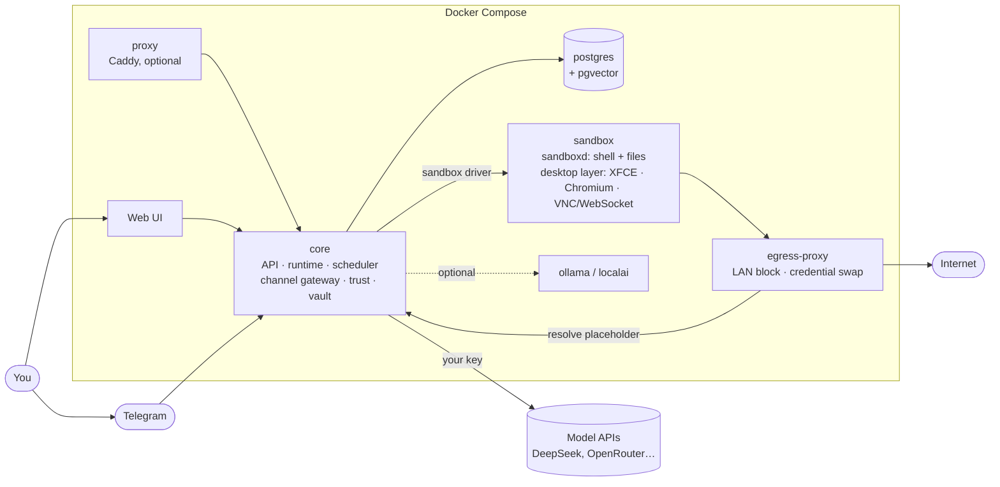
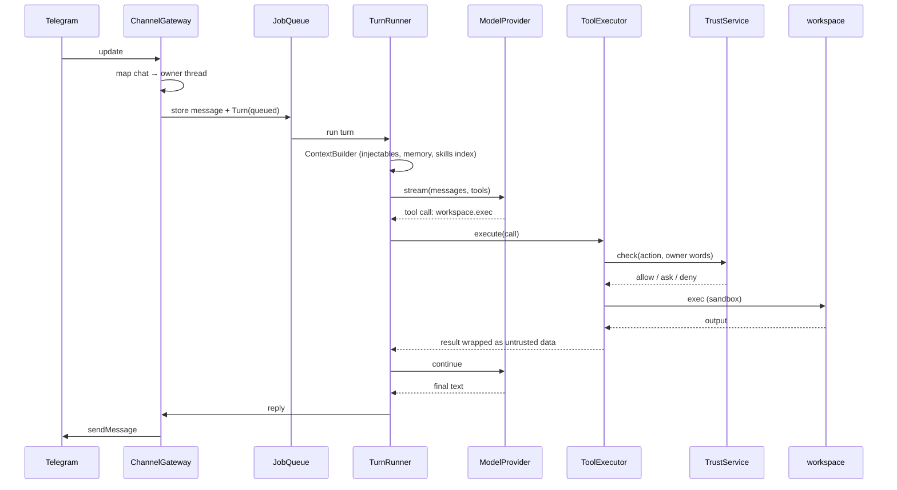

# Target architecture

This page proposes the overall shape of Shitsuji v2. Each [feature file](features/) fills in one part.

## Design goals

1. **Ports and adapters (hexagonal architecture).** The core depends only on interfaces. Model providers,
   databases, channels, the sandbox, the browser and the desktop are adapters behind those interfaces.
2. **One composition root.** One file builds the object graph from configuration. Nothing else reads
   `process.env` or constructs adapters. (Today `index.ts` and `tui/app.tsx` each do this.)
3. **Policy in code, not in the prompt.** What the agent may do is decided by server code (the trust service),
   not by instructions the model can be talked out of.
4. **Durable by default.** Every message, schedule fire and background check becomes a stored `Turn`. A
   restart loses nothing that was acknowledged.
5. **The agent's computer is untrusted.** Containers get no API keys, no database access and no Docker socket.
6. **Small prompts.** Tools, skills and memory load on demand, so small and local models stay usable.

## Our own agent loop

The reference projects either wrap an existing harness (Pi in nod; coding CLIs in openbot and OpenMausBot) or
use a framework (CopilotKit in openfuse). We recommend **keeping Shitsuji's own loop**:

- the target models are BYOK and local (DeepSeek, Ollama, LocalAI), which the coding CLIs do not serve well;
- the object-oriented design is a stated goal, and an own loop keeps every step inspectable;
- the loop is small. The hard parts (durability, policy, sandboxing) live around it either way.

An adapter could still wrap an external harness later as just another `AgentEngine`.

## Layers

```
src/
├── domain/        Entities and value objects. No I/O. (Thread, Session, Turn, Task, Message, ToolCall,
│                  Approval, MemoryNote, Skill, Schedule, Money…)
├── ports/         Interfaces the application needs. (ModelProvider, ChannelAdapter, ThreadRepository,
│                  JobQueue, WorkspaceBackend, BrowserBackend, ComputerBackend, SecretStore, Clock, …)
├── application/   Services and use cases. (TurnRunner, ContextBuilder, ToolExecutor, TrustService,
│                  MemoryService, SkillLibrary, TaskService, Scheduler, ProactivityEngine, UsageLedger, …)
├── adapters/      Implementations of ports. (openai-compatible/, anthropic/, postgres/, telegram/, web/,
│                  docker-workspace/, cdp-browser/, vnc-desktop/, mcp/, …)
├── interfaces/    Inbound edges: HTTP + WebSocket API (Hono), CLI, TUI.
├── plugins/       Built-in plugins (each bundles adapters and tools behind a manifest).
└── composition/   The composition root: config → object graph. The only place that imports adapters.
```

**Import rules** (checked by a small script in CI, as nod does):

| Folder | May import |
|--------|-----------|
| `domain` | `domain` |
| `ports` | `ports`, `domain` |
| `application` | `application`, `ports`, `domain` |
| `adapters` | `adapters`, `ports`, `domain`, vendor SDKs |
| `interfaces` | `interfaces`, `application`, `ports`, `domain` |
| `composition` | everything |

## Design patterns and where they apply

| Pattern | Where | Why |
|---------|-------|-----|
| **Ports and adapters** | Every external system | Swap DeepSeek for Ollama, Docker for a VM, Postgres for SQLite in tests |
| **Composition root + constructor injection** | `composition/` | No hidden singletons; tests build small graphs |
| **Strategy** | `ModelRouter` picks a provider/model; `MemoryRecall` picks keyword or vector search | Behaviour chosen by configuration |
| **Adapter** | Each provider and channel translates between its wire format and domain types | Keeps vendor shapes out of the core |
| **Template method** | `BaseTool`, `BaseChannelAdapter`, `BaseModelProvider` | Shared validation, logging and error handling; subclasses fill in one method |
| **Chain of responsibility (middleware)** | `ToolExecutor` pipeline: validate → trust check → approval → execute → redact → wrap untrusted | Each concern in one class; easy to add more |
| **Command** | `ActionRequest` (a tool call with exact arguments) stored for approval and run once | Approvals bind to exact actions and can be replayed safely |
| **State machine** | `Turn`, `Task`, `Approval` lifecycles | Illegal transitions become errors, not bugs |
| **Observer** | `EventBus` (today's `MessageBus`, made an injected instance) | UI updates, logging, metrics, proactivity signals |
| **Repository** | One per aggregate (`ThreadRepository`, `TaskRepository`, `MemoryRepository`, …) | Storage hidden behind the domain |
| **Unit of work** | `TurnLock`: every write a turn makes runs only while the turn is still `running` | A stopped turn cannot write late |
| **Composite** | `ContextBuilder` holds `ContextInjectable`s | Kept from today |
| **Plugin / registry** | `PluginManager`, `ToolRegistry`, `ChannelRegistry`, `ProviderRegistry` | Extend without editing the core |
| **Decorator** | `CachingModelProvider`, `MeteredModelProvider` (records usage), `RetryingModelProvider` | Cross-cutting behaviour without subclass explosion |

## What we keep from today

| Today | Becomes |
|-------|---------|
| `MessageBus` | `EventBus` port with an in-process implementation; plus a persisted `turn_events` log |
| `ContextInjectable` and its conditions | Kept as is, rendered by `ContextBuilder`; conditions fixed and extended |
| `BaseLLMProvider` / `LLMProvider` | `ModelProvider` port with capabilities, streaming and tool-call normalisation |
| `BaseTool` / `ToolRegistry` | Kept; tools gain an `effect`, a zod schema and an execution `target` (core, workspace, desktop) |
| `Channel` / `BaseChannel` | `ChannelAdapter` port; a `ChannelGateway` routes messages to threads |
| `PluginManager` | Becomes the real loading mechanism for channels, providers and tool packs |
| `Session` | Split into `Thread` (one per owner), `Session` (one per line of work) and `Turn` (one run) |
| `SessionStore` (JSON files) | Postgres repositories |
| zod config | One validated `ShitsujiConfig`, read only by the composition root |
| Ink TUI | A client of the HTTP API, built early (start of pass 2) as the first interface for troubleshooting before the web UI is ready |

## Containers



| Service | Image | Holds secrets? | Network | Notes |
|---------|-------|----------------|---------|-------|
| `core` | `shitsuji/core` (Node 22) | Yes: model keys, vault, Telegram token | `internal` + `egress` | The only service that talks to the database and to model APIs |
| `postgres` | `pgvector/pgvector` | DB password | `internal` only | Threads, turns, tasks, memory, usage, jobs (pg-boss) |
| `sandbox` | `shitsuji/sandbox` (Debian + Python, Node, git, ffmpeg, pandoc, … + `sandboxd`), or `shitsuji/sandbox-desktop` built on it (XFCE + Xvfb/x11vnc + Chromium + LibreOffice + AT-SPI) | **None** (placeholders only) | `sandbox` only | Used by the `shitsuji` sandbox driver ([F08](features/F08-workspace-sandbox.md)). Runs commands as an unprivileged user through `sandboxd`, and hosts the agent's GUI and browser. Chromium exposes CDP only on the `sandbox` network; `core` serves the noVNC viewer for "Take control". No route to Postgres. |
| `egress-proxy` | `shitsuji/egress` (Node) | Its own CA key and a token for `core`; no stored secrets | `sandbox` + `internal` + `egress` | The sandbox's only way out: blocks your LAN and `core`, tunnels ordinary HTTPS, and swaps placeholders for real credentials on bound hosts ([F12](features/F12-secrets-vault.md#the-credential-injecting-egress-proxy)) |
| `ollama` / `localai` | upstream | None | `internal` | Compose **profile** `local-models`, off by default |
| `proxy` | `caddy` | TLS certs | `public` + `internal` | Optional HTTPS for remote access. Binds `127.0.0.1` by default. |

**Hardening for `sandbox`** (taken from nod and openfuse): `cap_drop: [ALL]`,
`no-new-privileges`, PID, memory and CPU limits, read-only root where possible, `tmpfs` for `/tmp`, a
non-root user, no Docker socket, no host mounts, and **no direct internet**: all outbound traffic goes through
`egress-proxy`, which blocks private address ranges (your LAN, `core`) and is where credentials are attached.

**Sandbox drivers** (decisions W1–W6 in [05-open-questions.md](05-open-questions.md)). `core` reaches the
sandbox through a `SandboxDriver` port. A driver advertises its capabilities (exec, files, desktop, browser,
lifecycle, egress); `core` owns the tools, registers only the ones the driver supports, and probes the egress
claims at startup. Drivers: `host` (today's tools, no isolation), `opensandbox` (a self-hosted
[OpenSandbox](https://github.com/opensandbox-group/OpenSandbox) server, optional Compose profile) and `shitsuji`
(the `sandbox` and `egress-proxy` services above, the default once it passes the conformance suite).

**Shared files.** The workspace and the desktop are one container, so commands, GUI apps and the browser share
`/workspace`. A `handoff` volume is shared between `sandbox` and `core`, for channel attachments coming in and
files going back to you.

**Why `core` does not get the Docker socket.** Docker-socket access is root on the host. The sandbox is a
long-lived Compose service instead, and `core` reaches it through `sandboxd` with a shared token. If we later want one sandbox per task, we add a restricted Docker socket proxy that only
allows creating containers from our own images.

## Request flow



## Technology choices

| Concern | Choice | Alternative |
|---------|--------|-------------|
| Language / runtime | TypeScript, Node 22+ (as today) | — |
| HTTP + WebSocket | Hono (already a dependency) + `@hono/node-ws` | Fastify |
| Validation | zod (already used) → JSON Schema for tools | TypeBox |
| Database | PostgreSQL 17 + pgvector | SQLite + sqlite-vec for a single-container mode |
| Query layer | Kysely (typed SQL, no heavy ORM) | Drizzle |
| Jobs | pg-boss (queue in Postgres) | BullMQ + Redis |
| Browser control | Playwright `connectOverCDP` to the desktop's Chromium | Puppeteer |
| Desktop control | AT-SPI tree (Python `gi` helper) first, then `xdotool` + screenshots + Tesseract OCR, inside the desktop daemon | Direct AT-SPI over D-Bus from Node |
| Email | imapflow (IMAP + IDLE) + nodemailer (SMTP) + mailparser, in `core` behind an `EmailBackend` port | Gmail API; Himalaya CLI run by `core` |
| Web UI | React + Vite, served by `core` | SolidJS |
| Telegram | grammY | Telegraf |
| MCP | `@modelcontextprotocol/sdk` client | — |
| Tests | Vitest (already installed) + Testcontainers for Postgres | — |
