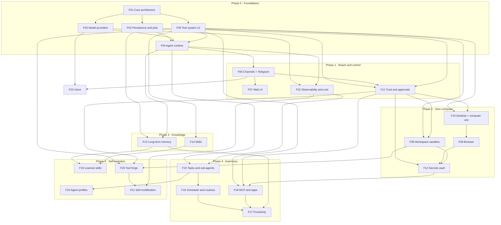

# Feature overview

The features we want to bring to Shitsuji, ranked in build order, with a short description of each. Every
feature has its own file in [features/](features/) with the design, the classes involved, the changes to
today's code, dependencies and acceptance criteria.

**Feature IDs are fixed names, not ranks.** The rank column gives the build order, which follows the
dependency graph below.

Effort: **S** about a few days, **M** one to two weeks, **L** several weeks (for one developer with an AI
assistant). These are rough guides for ordering, not estimates to plan against.

## Ranked list

### Phase 0 — Foundations

The core has to be rewired before anything else is worth building on it.

| Rank | ID | Feature | Effort | Description |
|------|----|---------|--------|-------------|
| 1 | [F01](features/F01-core-architecture.md) | Core architecture and composition root | M | Reorganise `src/` into domain, ports, application, adapters and a composition root. Turn the global `messageBus` into an injected typed `EventBus`, make `PluginManager` the real loader, add import-direction checks and the first tests. |
| 2 | [F02](features/F02-persistence.md) | Persistence and durable jobs | M | PostgreSQL with repositories per aggregate and a job queue (pg-boss). Replaces JSON session files. Gives every later feature durable state and restart recovery. |
| 3 | [F03](features/F03-model-providers.md) | Model providers and router | M | A generic OpenAI-compatible provider (DeepSeek, OpenRouter, Ollama, LocalAI, vLLM…) with correct streaming and tool calls, a fixed Anthropic adapter, a model catalogue with capabilities and prices, and a router that picks a model per purpose (chat, cheap classification, vision, embeddings). |
| 4 | [F05](features/F05-tool-system.md) | Tool system v2 | M | Tools declare a zod schema, an **effect** (read, write, external, payment…) and where they run. Execution goes through a middleware pipeline. Deferred discovery (`tool_search`) keeps prompts small. |
| 5 | [F04](features/F04-agent-runtime.md) | Agent runtime: threads, sessions and turns | L | One thread per owner across all channels; sessions for each line of work; every message, schedule fire or resume is a stored `Turn` with a state machine. Step limits, Stop, steering with new messages, context compaction, and `SOUL.md` standing instructions. Keeps `ContextInjectable`. |

### Phase 1 — Reach me and keep me in control

| Rank | ID | Feature | Effort | Description |
|------|----|---------|--------|-------------|
| 6 | [F06](features/F06-channel-gateway.md) | Channel gateway and Telegram | M | A `ChannelAdapter` port, a gateway that maps chats to the owner's thread, a rich outbound message model (text, files, buttons, approval cards) degraded per channel, and the **Telegram** adapter. |
| 7 | [F07](features/F07-web-ui.md) | Web UI | L | Chat with streaming and activity, task list, approval cards, live view and **Take control** of the desktop, memory and skills editors, settings and usage. Served by `core` over HTTP and WebSocket. |
| 8 | [F22](features/F22-observability-and-cost.md) | Observability, cost and evals | M | One usage ledger for every model call, monthly and per-task spending limits, an activity log with receipts, structured logs, a health scanner and a small evaluation harness. Started early and extended in later phases. |
| 9 | [F11](features/F11-trust-and-approvals.md) | Trust and approvals | L | A server-side policy service decides allow / ask / deny for every action from the owner's own words and standing rules. Approvals are bound to exact arguments and run once. Outside content reaches the model wrapped as untrusted data. |

### Phase 2 — Its own computer

| Rank | ID | Feature | Effort | Description |
|------|----|---------|--------|-------------|
| 10 | [F08](features/F08-workspace-sandbox.md) | Workspace sandbox container | M | A hardened Linux container with a command supervisor (timeouts, process-tree kill, output caps) and file API. Replaces today's host shell and file tools. |
| 11 | [F10](features/F10-desktop.md) | Desktop environment and computer use | L | A desktop container (XFCE on a virtual display, Chromium, noVNC) with a control daemon that reads apps through their accessibility tree (AT-SPI) first and falls back to screenshots, mouse and keyboard. A `ComputerBackend` port so a VM or cloud desktop can replace it. Live view and Take control in the web UI. |
| 12 | [F09](features/F09-browser.md) | Browser automation | M | Drive the desktop's Chromium through CDP: navigate, accessibility snapshot with element refs, click, type, download. Persistent profiles. Hand-off to you for sign-ins and CAPTCHAs. |
| 13 | [F12](features/F12-secrets-vault.md) | Secrets vault | M–L | Encrypted store for API keys, site logins and one-time-code seeds, each bound to the hosts it may go to. Neither the model nor any code the agent can change holds a real value: `core` attaches it, types it into the page, or the egress proxy swaps a placeholder for it on the way out, so even agent-written tools can call APIs safely. Redaction is the safety net. |

### Phase 3 — Knowledge

| Rank | ID | Feature | Effort | Description |
|------|----|---------|--------|-------------|
| 14 | [F13](features/F13-long-term-memory.md) | Long-term memory | L | Structured notes (about you, preferences, people, routines, lessons) learned only from your own messages, with source quotes, tentative and confirmed states, archive instead of delete, keyword and vector recall, and an editable Markdown view. |
| 15 | [F14](features/F14-skills.md) | Skills library | S | Task guides in the Agent Skills format (`SKILL.md`). Only names and descriptions go in the prompt; the agent reads a guide when a task matches. |

### Phase 4 — Autonomy

| Rank | ID | Feature | Effort | Description |
|------|----|---------|--------|-------------|
| 16 | [F15](features/F15-tasks-and-subagents.md) | Tasks and sub-agents | L | A task ledger for substantial work, one session per task, parallel tasks, questions back to you, and `delegate` for short-lived helper agents. Budgets, depth limits and stall detection. |
| 17 | [F16](features/F16-scheduler-and-routines.md) | Scheduler, routines and watches | M | Cron and one-off schedules, webhook triggers, page and price watches, quiet runs that report only real news. |
| 18 | [F18](features/F18-integrations-mcp.md) | Integrations: MCP and connected apps | M | An MCP client for any MCP server, plus first-party connectors: email (IMAP/SMTP in `core`, account-access mail hidden, sends bound to an approved draft) and calendar. Every app action goes through the trust service. |
| 19 | [F17](features/F17-proactivity.md) | Proactivity engine | L | An observer that watches change signals from your apps and tasks, decides cheaply whether something needs you, prepares the work, and nudges you only when it matters, respecting quiet hours and a budget. |

### Phase 5 — Self-evolution

| Rank | ID | Feature | Effort | Description |
|------|----|---------|--------|-------------|
| 20 | [F19](features/F19-learned-skills.md) | Learned skills | M | After a task, the agent writes or patches a reusable procedure. Versioned, reviewable, loaded as untrusted guidance. |
| 21 | [F20](features/F20-tool-forge.md) | Tool forge: self-authored tools | L | The agent writes a new tool in the workspace or desktop, tests it there, and proposes it. After your approval it is registered as a sandboxed plugin with a version history and rollback. |
| 22 | [F24](features/F24-agent-profiles.md) | Agent profiles and specialists | M | Named agent profiles (instructions, model, tools, skills), created by you or by the agent, used for delegation and specialist work. |
| 23 | [F21](features/F21-self-modification.md) | Self-modification pipeline | L | **Design first, build last.** The agent proposes changes to Shitsuji's own code as a branch, tests run in a separate container, and nothing deploys without your review. Canary start and automatic rollback. |

### Later

| Rank | ID | Feature | Effort | Description |
|------|----|---------|--------|-------------|
| 24 | [F23](features/F23-voice.md) | Voice | M | Voice notes in Telegram (speech-to-text), spoken replies (text-to-speech) with a spoken register, later live calls. |

## Dependency graph

An arrow `A --> B` means **B needs A**.

## Milestones

Each milestone ends with something you can use.

| Milestone | After | You can… |
|-----------|-------|----------|
| **M1 Solid core** | F01–F05 | Chat in the CLI with DeepSeek or a local model; the conversation survives restarts; tool calls work on every provider. |
| **M2 In my pocket** | F06, F07, F22, F11 | Talk to Shitsuji from Telegram and the web UI, approve actions from either, see what it did and what it cost. |
| **M3 It has a computer** | F08, F10, F09, F12 | Watch it run commands and browse in its own desktop, take control when it needs a login, keep passwords out of the model. |
| **M4 It knows me** | F13, F14 | Tell it something once; it remembers, shows you why, and lets you edit it. |
| **M5 It works on its own** | F15–F18 | Give it long jobs and schedules; it checks your apps and tells you when something needs you. |
| **M6 It gets better** | F19–F21, F24 | It writes its own procedures and tools, with your approval, and proposes improvements to itself. |

## How the brief maps to features

| From the brief | Features |
|----------------|----------|
| "Powerful, flexible, multidisciplinary" | F05, F08, F09, F10, F14, F18 |
| "Proactive" | F16, F17 |
| "Its own desktop and browser" | F08, F09, F10 |
| "Self-evolving" | F19, F20, F21, F24 — see [04-self-evolution.md](04-self-evolution.md) |
| "Docker Compose with several containers" | [02-target-architecture.md](02-target-architecture.md#containers), F08, F10 |
| "DeepSeek, BYOK, later Ollama / LocalAI" | F03 |
| "Web UI and Telegram, nicely abstracted" | F06, F07 |
| "Clear, object-oriented design" | F01, [02-target-architecture.md](02-target-architecture.md#design-patterns-and-where-they-apply) |
