# Class map

A picture of the **target** code structure, gathered from the feature files. This is speculative: it shows
the shape we are aiming for, not code that exists. Names come from the feature docs. The few names that
appear only here are marked *(named here)*.

One diagram per area, because a single diagram with ~150 classes is unreadable. Each section links to the
feature file that explains it.

## How to read the diagrams

| Arrow | Meaning |
|-------|---------|
| `A <\|-- B` (solid, hollow triangle) | B **extends** A |
| `A <\|.. B` (dashed, hollow triangle) | B **implements** interface A |
| `A *-- B` (filled diamond) | A **owns** B (B lives and dies with A) |
| `A o-- B` (hollow diamond) | A **holds** a list of B (B lives elsewhere) |
| `A --> B` | A **uses** B (a dependency injected into A) |
| `A ..> B` | A **creates or returns** B |

`<<interface>>` marks a **port** (in `src/ports`). Classes that implement a port are **adapters** (in
`src/adapters`). Everything else is **application** code (in `src/application`) or **domain** (in `src/domain`).

## 0. Layers

The rule that holds the structure together: arrows only point inwards. Domain knows nothing; adapters know
the ports they implement; only the composition root knows everything.

```mermaid
flowchart TB
  comp["composition/<br/>createShitsuji · loadConfig"] --> iface & app & adapters & plugins
  iface["interfaces/<br/>HTTP API · WebSocket · CLI · TUI"] --> app
  plugins["plugins/<br/>built-in + user plugins"] --> ports
  adapters["adapters/<br/>Postgres · OpenAI-compatible · Telegram · Docker · CDP · IMAP …"] --> ports
  app["application/<br/>runtime · trust · memory · tools · tasks · scheduler …"] --> ports & domain
  ports["ports/<br/>interfaces only"] --> domain
  domain["domain/<br/>Thread · Session · Turn · Task · Approval …"]
```

## 1. Composition root and plugins

[F01](features/F01-core-architecture.md)

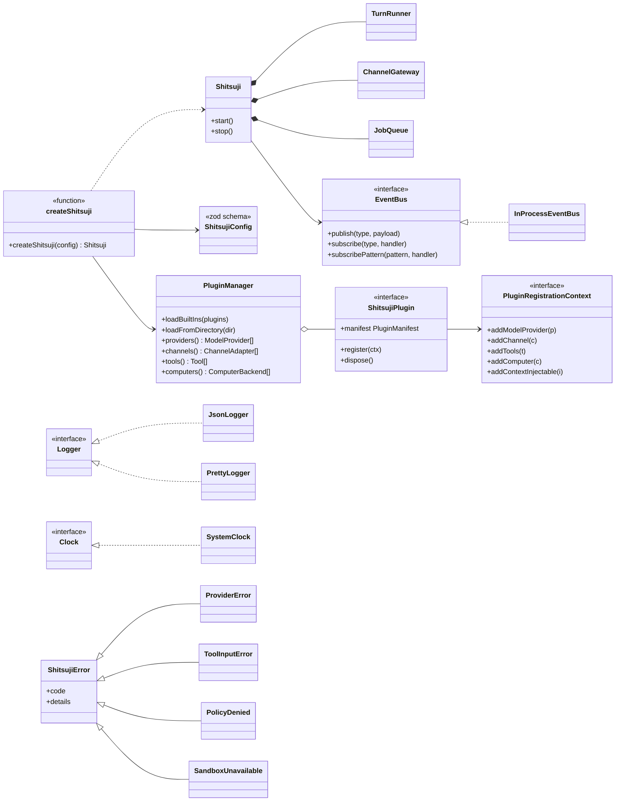

## 2. Domain model

[F02](features/F02-persistence.md), [F04](features/F04-agent-runtime.md), [F11](features/F11-trust-and-approvals.md),
[F15](features/F15-tasks-and-subagents.md). Plain objects with state machines; no I/O.

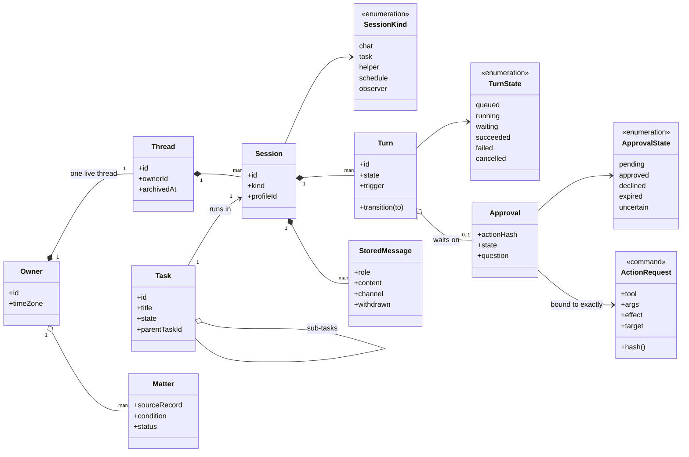

## 3. Model providers

[F03](features/F03-model-providers.md), [F22](features/F22-observability-and-cost.md). Strategy (one provider per
endpoint) plus Decorator (metering, retries, redaction wrap any provider).

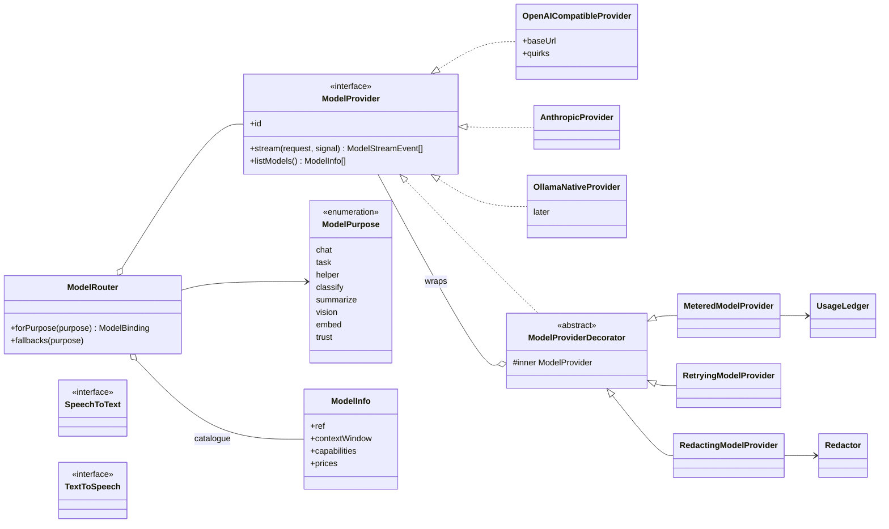

`ModelProviderDecorator` is *(named here)*: the docs name the three decorators but not their shared base.
Speech ports from [F23](features/F23-voice.md) sit beside the model ports and are metered the same way.

## 4. Agent runtime

[F04](features/F04-agent-runtime.md). Template Method (`TurnRunner` fixes the turn's steps), Composite
(`ContextBuilder` is made of `ContextInjectable`s), State (`Turn`).

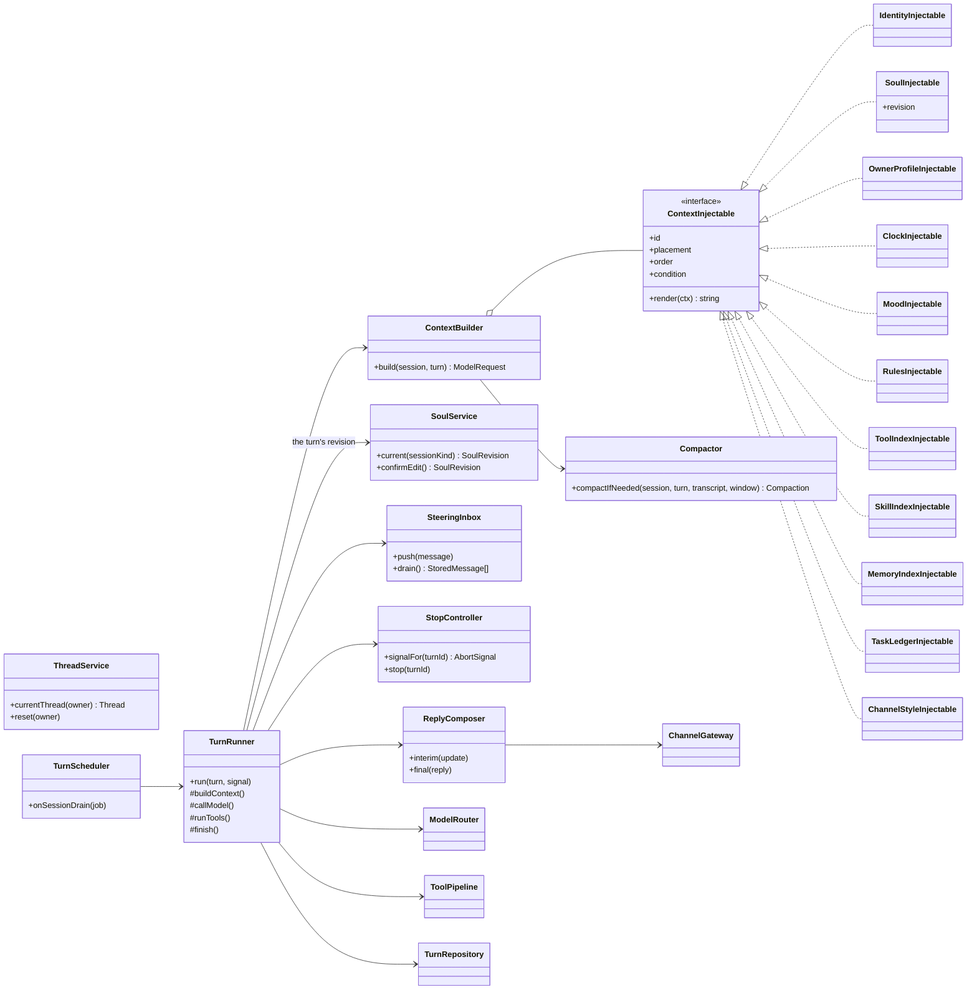

## 5. Tools

[F05](features/F05-tool-system.md), [F18](features/F18-integrations-mcp.md), [F20](features/F20-tool-forge.md).
Every tool, whatever its origin, is a `BaseTool`; every call passes the same Chain of Responsibility.

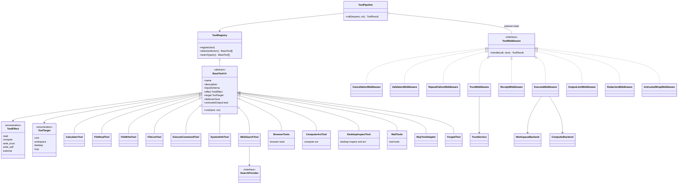

`ToolPipeline`, and the grouped classes `BrowserTools`, `ComputerActTool`, `DesktopInspectTool` and `MailTools`,
are *(named here)*: the docs list those tools by name (`browser.click`, `mail.send`, …), and each group will
be several small classes sharing a base.

## 6. Channels

[F06](features/F06-channel-gateway.md), [F07](features/F07-web-ui.md), [F23](features/F23-voice.md). Adapter pattern;
the gateway turns any channel's message into a turn.

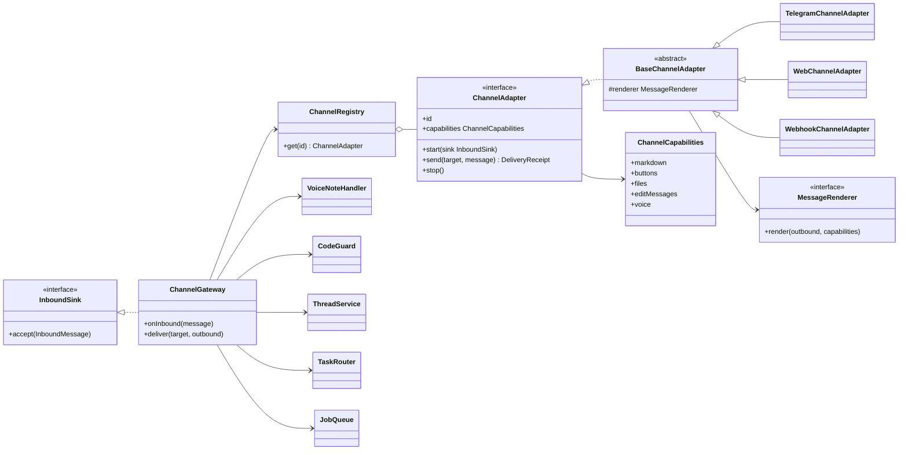

`TelegramChannelAdapter` and `WebChannelAdapter` are *(named here)*; the docs describe them but give no class
names.

## 7. Trust, approvals and secrets

[F11](features/F11-trust-and-approvals.md), [F12](features/F12-secrets-vault.md). Facades over small,
single-purpose classes.

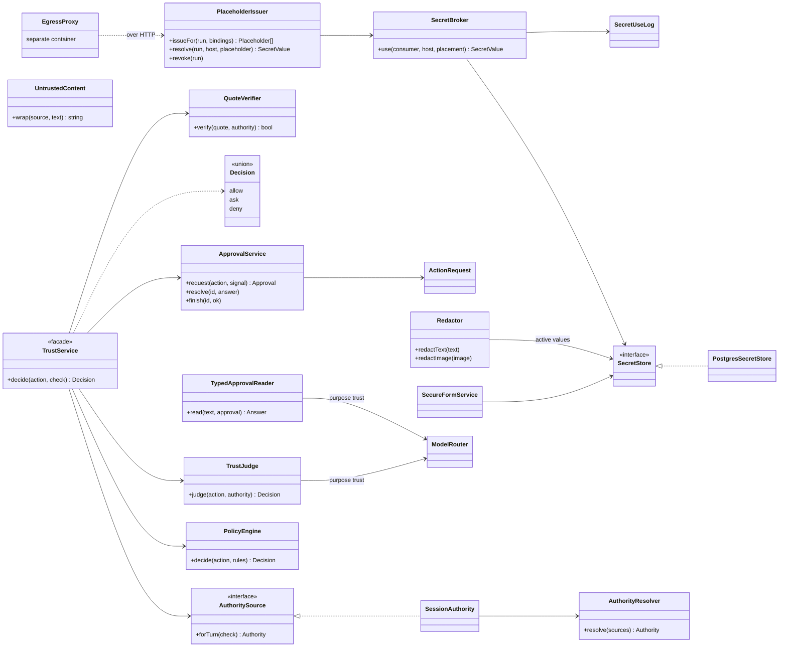

`PostgresSecretStore` and `EgressProxy` are *(named here)*. The egress proxy is its own service, not a class in
`core`; it is shown to make the dependency visible.

## 8. The agent's computers

[F08](features/F08-workspace-sandbox.md), [F09](features/F09-browser.md), [F10](features/F10-desktop.md). Three ports so
each environment can move to a VM or a cloud sandbox without touching the runtime.

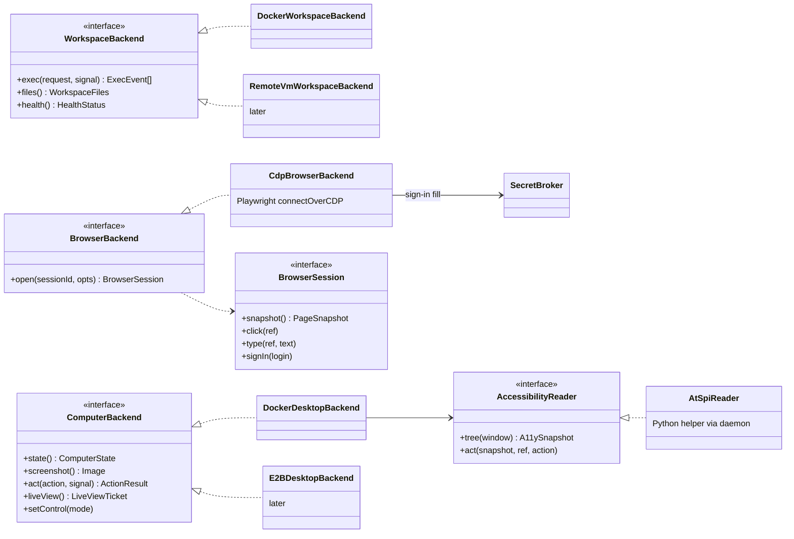

`CdpBrowserBackend`, `AccessibilityReader` and `AtSpiReader` are *(named here)*. Inside the containers, the
workspace and desktop **daemons** are separate small programs that these adapters call over HTTP.

## 9. Integrations

[F18](features/F18-integrations-mcp.md).

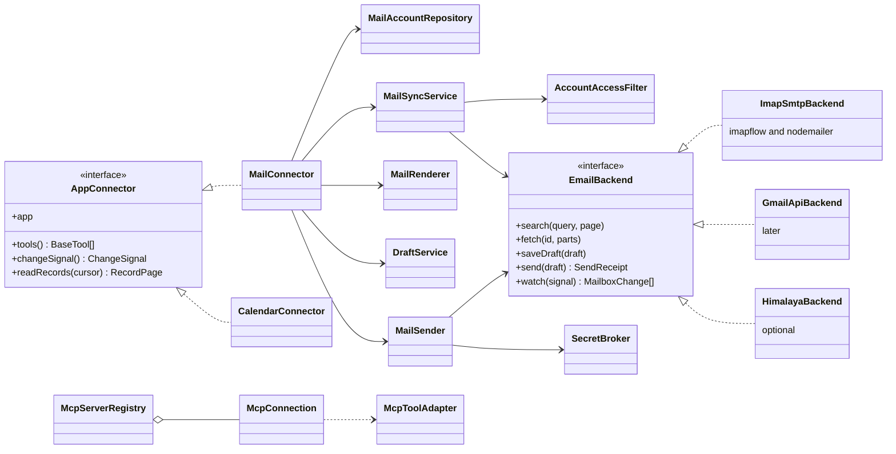

The mail renderer was first called `MessageRenderer`, which clashed with the channel `MessageRenderer` in F06.
F18 now uses `MailRenderer` too.
`CalendarConnector` is *(named here)*.

## 10. Memory and skills

[F13](features/F13-long-term-memory.md), [F14](features/F14-skills.md), [F19](features/F19-learned-skills.md).

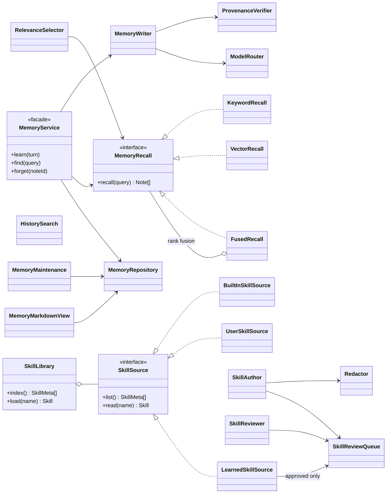

`FusedRecall` is *(named here)* for the "combined by rank fusion" step in F13.

## 11. Autonomy: tasks, schedules, proactivity

[F15](features/F15-tasks-and-subagents.md), [F16](features/F16-scheduler-and-routines.md),
[F17](features/F17-proactivity.md), [F24](features/F24-agent-profiles.md).

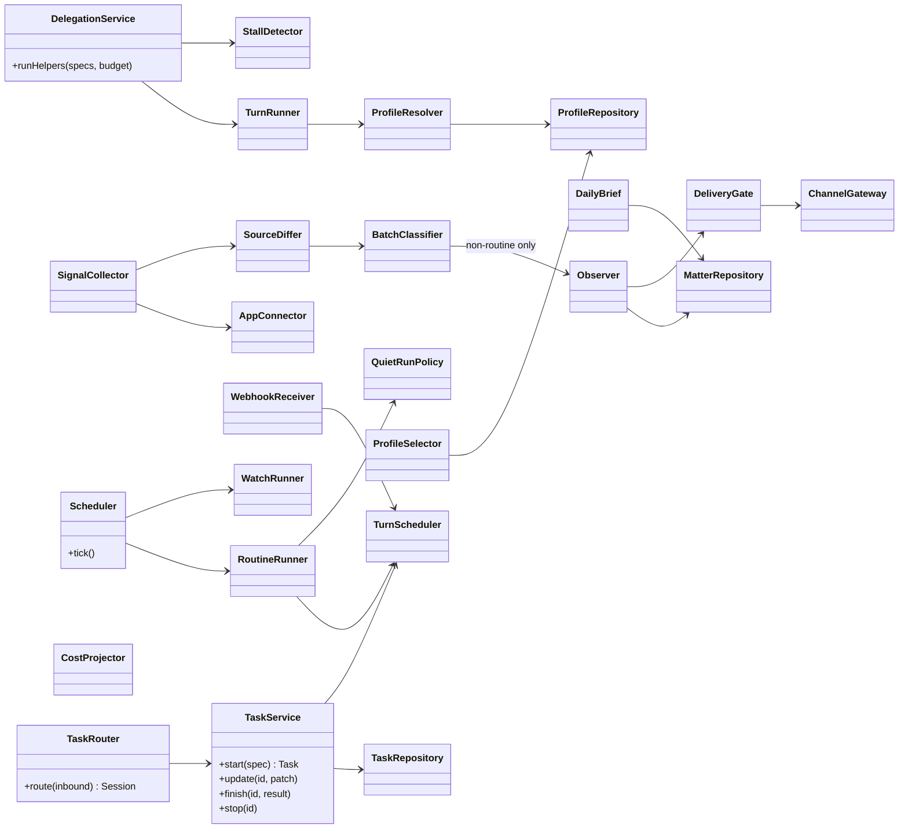

## 12. Self-evolution

[F20](features/F20-tool-forge.md), [F21](features/F21-self-modification.md).

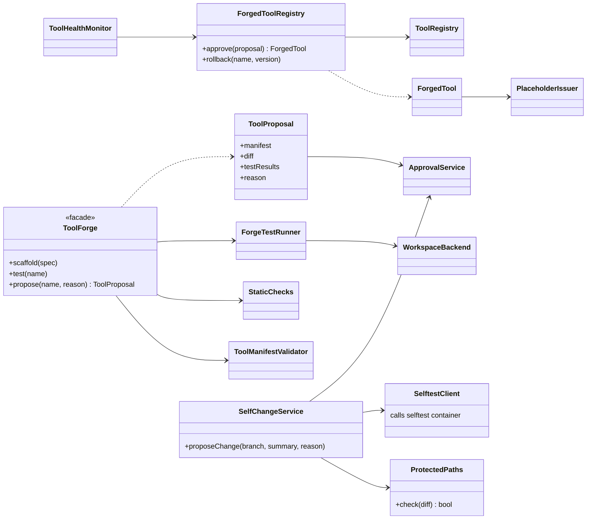

F21 is mostly a process (branches, a `selftest` container, canary deploys), so `SelfChangeService`,
`ProtectedPaths` and `SelftestClient` are *(named here)* as the small amount of code `core` needs for it.

## 13. Persistence and observability

[F02](features/F02-persistence.md), [F22](features/F22-observability-and-cost.md). Repository and Unit of Work over
Postgres, with in-memory adapters for tests.

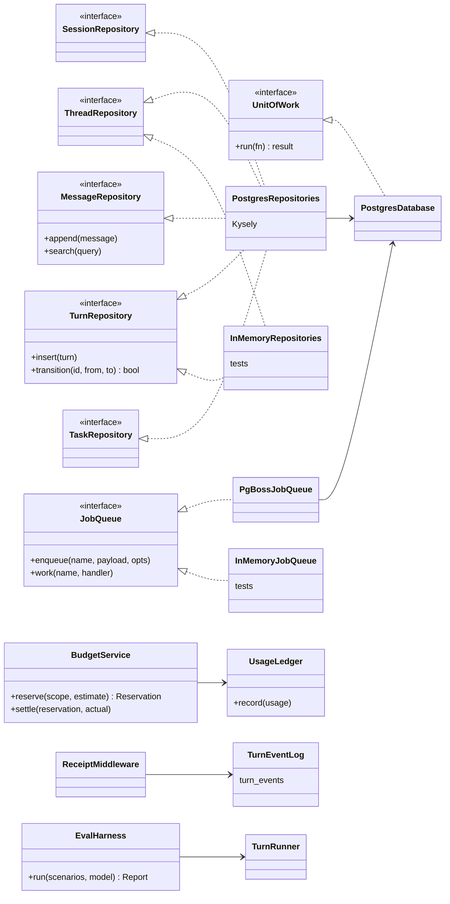

`TurnEventLog` and `EvalHarness` are *(named here)* for the `turn_events` writer and the `pnpm eval` runner in
F22.

## Design patterns at a glance

| Pattern | Where | Section |
|---------|-------|---------|
| Ports and adapters | Every `<<interface>>` and its implementations | all |
| Composition root | `createShitsuji` | 1 |
| Plugin / registry | `PluginManager`, `ToolRegistry`, `ChannelRegistry`, `ForgedToolRegistry` | 1, 5, 6, 12 |
| Observer | `EventBus` | 1 |
| State machine | `Turn`, `Task`, `Approval` | 2 |
| Command | `ActionRequest` | 2, 7 |
| Strategy | `ModelProvider`, `MemoryRecall`, `EmailBackend`, `SearchProvider` | 3, 9, 10 |
| Decorator | `Metered` / `Retrying` / `RedactingModelProvider` | 3 |
| Template Method | `TurnRunner`, `BaseTool`, `BaseChannelAdapter` | 4, 5, 6 |
| Composite | `ContextBuilder` + `ContextInjectable`s, `FusedRecall` | 4, 10 |
| Chain of Responsibility | `ToolPipeline` + `ToolMiddleware`s | 5 |
| Adapter | `McpToolAdapter`, channel adapters | 5, 6, 9 |
| Facade | `Shitsuji`, `TrustService`, `MemoryService`, `ToolForge` | 1, 7, 10, 12 |
| Repository / Unit of Work | Section 13 | 13 |
