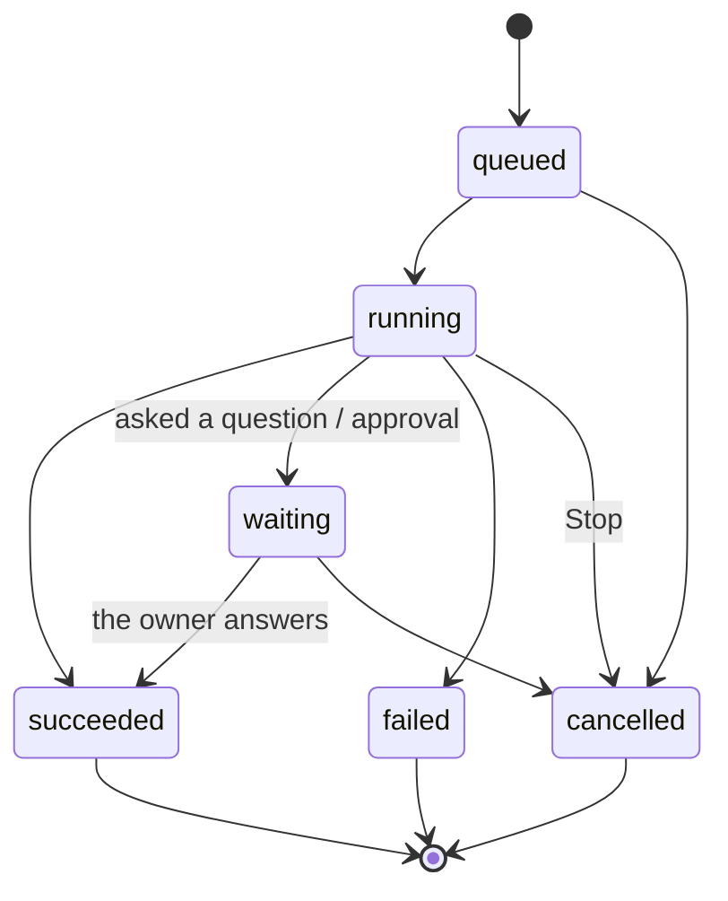

# F04 — Agent runtime: threads, sessions and turns

| Phase | Rank | Effort | Depends on | Needed by |
|-------|------|--------|-----------|-----------|
| 0 Foundations | 5 | L | F01, F02, F03, F05 | F06, F13, F15, F22, F24 |

## What it is

The heart of Shitsuji rebuilt around three concepts, plus the loop that runs a turn:

| Concept | Meaning | Lifetime |
|---------|---------|----------|
| **Thread** | Your one conversation with Shitsuji, shared by every channel | Until you reset it |
| **Session** | One line of work with its own transcript: the main chat, a task, a schedule run, the observer, a helper | Across many turns |
| **Turn** | One run of the agent, started by a message, a task dispatch, a schedule fire, an event or a resume | Until it succeeds, waits, fails or is cancelled |

## Where Shitsuji is today

`Agent.send()` adds a message to a `Session` and runs `runLoop()`: call the model, run tool calls, repeat. The
loop has no step limit, no cancellation, no streaming, and a new session is created for every message
([bugs 1, 4, 8](../00-current-state.md#bugs-and-gaps-found)). `ContextInjectable`s build the system prompt.

## Inspiration

- **nod:** one thread per owner across web, Telegram and WhatsApp; turns as rows with a source and a session;
  a session runs one turn at a time while sessions run in parallel; turns are never retried; Stop ends a turn
  at once and withdraws it; messages that arrive while a turn runs are **steered** into it at the next model
  boundary; compaction with a summary at the lightest reasoning effort; screenshot pruning.
- **OpenMausBot:** `SOUL.md` standing instructions; stall detection (two continuations with no successful tool
  call, or the same error three times).
- **Shitsuji today:** `ContextInjectable` with conditions and priorities. **Kept.**

## Design

### Turn state machine



`Turn` is a domain class that owns its transitions (`turn.start()`, `turn.wait(at)`, …) and throws on
an illegal one. The repository persists them with compare-and-set ([F02](F02-persistence.md)).

A `waiting` turn's question is stored as Shitsuji's reply, so it is part of the transcript; the owner's
next message in that session ends the waiting turn (`succeeded`, "answered") and starts a `resume` turn
([F22](F22-observability-and-cost.md) check-in is the first producer, [F11](F11-trust-and-approvals.md)
approvals the next).

### Classes

| Class | Responsibility |
|-------|---------------|
| `ThreadService` | Finds or creates the owner's thread; reset archives it and starts a new one |
| `TurnScheduler` | Job handler for `session.drain`: for each session with no running turn, start its oldest queued turn |
| `TurnRunner` | Runs one turn: builds context, streams the model, executes tools, handles steering, writes the result |
| `ContextBuilder` | Composite of `ContextInjectable`s plus transcript selection and compaction |
| `Compactor` | Summarises older transcript when it nears the model's window; keeps the full transcript stored || `SteeringInbox` | Collects owner messages for a running session; `TurnRunner` drains it before each model call |
| `StopController` | Holds the `AbortController` per running turn; Stop aborts, then marks the turn cancelled |
| `ReplyComposer` | Sends interim updates and the final reply through the gateway ([F06](F06-channel-gateway.md)) |

### The loop

```ts
class TurnRunner {
  async run(turn: Turn): Promise<void> {
    const ctx = await this.contextBuilder.build(turn);
    for (let step = 0; step < this.limits.maxSteps; step++) {
      ctx.absorb(this.steering.drain(turn.sessionId));            // new owner messages
      const stream = this.models.select(ctx.purpose).stream(ctx.toRequest(), turn.signal);
      const { text, toolCalls } = await this.consume(stream, turn); // streams deltas to the UI
      if (toolCalls.length === 0) return this.finish(turn, text);
      for (const call of toolCalls) {
        const outcome = await this.tools.execute(call, ctx.toolContext());
        if (outcome.kind === 'needs_approval' || outcome.kind === 'question') return this.wait(turn, outcome);
        ctx.addToolResult(call, outcome);
      }
      if (this.stall.detect(ctx)) return this.fail(turn, 'stalled', this.stall.reason());
      if (this.compactor.shouldCompact(ctx)) await this.compactor.compact(ctx);
    }
    return this.fail(turn, 'step_limit');
  }
}
```

Limits are configurable per session kind (`chat: 40 steps`, `task: 200`, `helper: 30`). Spending check-ins
come from [F22](F22-observability-and-cost.md).

### Context building

Everything the model sees besides the tool schemas comes from `ContextInjectable`s, the original Shitsuji
concept, kept and extended. Each injectable declares **where** it goes and **in what order**, so the layout
that keeps prompt caching effective is a property of the code rather than a convention people have to
remember.

#### Why placement matters: prompt caching

Every model call sends everything again: the system prompt, the tool schemas, then the whole history.
Providers cache the longest **prefix** that matches an earlier request (DeepSeek does this automatically;
Anthropic at the breakpoint the adapter sets after the system prompt). A change invalidates the cache from
the first changed token **onwards**. Because the history comes after the system prompt, changing the system
prompt makes the next call re-read the entire conversation. That's a one-off cost per change, which is fine
for something that changes rarely, but expensive for anything that changes every call.

The rule that follows: **order content by how often it changes, slowest first; anything that changes often
goes at the end.**

#### Placement and order

```ts
export type InjectionPlacement =
  | 'header'   // the system prompt. Stable content only: it starts the cached prefix.
  | 'context'  // inserted into the message history (e.g. a compaction summary at its start)
  | 'tail';    // attached to the latest turn, rebuilt on every call, never stored

export interface ContextInjectable {
  readonly id: string;
  readonly placement: InjectionPlacement;
  /** Ascending within a placement: -1 comes before 0. */
  readonly order: number;
  readonly condition: InjectionCondition;
  render(context: AgentRenderContext): string | null;
}
```

`order` replaces today's `priority`, which sorted the opposite way (higher first). The three existing
injectables are migrated, so their behaviour stays the same.

| Injectable | Placement | Order | Condition | Content | Changes |
|------------|-----------|-------|-----------|---------|---------|
| `IdentityInjectable` (kept) | header | -1 | always | Name, persona, writing rules | Almost never |
| `SoulInjectable` | header | 0 | always | The assembled standing instructions ([below](#standing-instructions-the-soul)) | On a new revision |
| `ToolIndexInjectable` | header | 1 | always | Names of deferred tools ([F05](F05-tool-system.md)) | When tools change |
| `RulesInjectable` (kept) | header | 2 | always | Safety and behaviour rules; untrusted-content rule | Almost never |
| `OwnerProfileInjectable` | header | 3 | always | Your name, time zone, locale (no clock) | Rarely |
| `ChannelStyleInjectable` | header | 4 | per session | "Telegram: no tables or headings" | Per session |
| `SkillIndexInjectable` | header | 5 | always | Skill names and descriptions ([F14](F14-skills.md)) | When skills change |
| `MemoryIndexInjectable` | header | 6 | memory on | Confirmed notes first ([F13](F13-long-term-memory.md)) | When notes change |
| `CompactionSummaryInjectable` | context | 0 | after compaction | Summary of the older messages, at the start of the history | On compaction |
| `RelevantMemoryInjectable` | tail | 0 | memory on | Notes selected for this request ([F13](F13-long-term-memory.md)) | Every turn |
| `TaskLedgerInjectable` | tail | 1 | chat sessions | Open tasks and recent results ([F15](F15-tasks-and-subagents.md)) | Often |
| `ClockInjectable` | tail | 2 | always | Local date and time | Every call |
| `MoodInjectable` | tail | 3 | mood on | One line of current mood ([F25](F25-mood.md)) | Often |

The SOUL comes before the safety rules in the prompt, so the identity text states the precedence
explicitly: standing instructions shape *how* Shitsuji behaves, and never override the rules, the trust
checks or approvals.

**How each placement is sent:**
- **header:** joined into `ModelRequest.system`, in order.
- **context:** turned into system-role messages at a fixed spot in the history (order 0 means first). Each
  provider adapter then maps these system notes to its own format, as it already does.
- **tail:** joined into one block, rendered **once per turn** and attached to the turn's opening owner
  message. It's never stored in the transcript. Every step of the turn sends it unchanged, so a tool loop
  keeps hitting the cache; the next turn renders it afresh on its own opening message, which only costs
  the cache from the previous turn's opening message on. A turn with no owner message in view (a
  scheduled one, say) gets it as a note at the end.

**A check that the header stays stable.** In development and in tests, the ContextBuilder compares each
header injectable's output with the previous call in the same session. If one changes on every call, it
logs a warning naming the injectable, which catches a clock or a mood slipping into the cached part.

**Tool results stay with their call.** When the context is built, each assistant `tool_call` is followed
immediately by its `tool_result`s. A message the owner steered in while the tool ran is moved after
those results, an orphan result is dropped, and a call with no result (a crash) gets a synthetic error
result, so every provider receives a valid history (#64).

**Conditions** are fixed and extended:
- `tool_used` reads the turn's tool calls (bug 8, fixed in S8);
- `once` is tracked per session;
- a new `session_kind` condition selects by session type.

#### Standing instructions: the SOUL

The SOUL is **assembled and evolving**, not a single file you edit:

- **Fragments.** It's composed of ordered fragments:
  - a base you write;
  - traits Shitsuji has proposed and you've confirmed;
  - optionally, parts for one session kind (for example, terser for background tasks).
- **Revisions.** The database holds the real copy as numbered revisions, with history and undo. Each
  turn records the revision it ran with. A `SOUL.md` export in the data folder lets you read it, and
  editing that file creates a new revision once you confirm the change.
- **Changes between turns only.** A new revision takes effect at the next turn, never in the middle of one.
  One confirmation makes one revision, so several edits are applied together rather than causing a
  cache miss each.
- **Shitsuji proposes, you decide.** Shitsuji may *propose* a change, shown as a before/after diff, but
  it's applied only after you confirm. This uses the approvals in [F11](F11-trust-and-approvals.md); until
  F11 exists, only you can change it.
- **A size cap,** 24 KB (as in OpenMausBot), so the header stays small.

The export holds the shared SOUL (the base and traits, assembled). Confirming an edit of it replaces the
base and traits with that one text, so there is exactly one thing to review; parts for one session kind
are not in the export and are kept. A confirmation names the hash of the text you reviewed (`GET
/api/soul` gives it), and if the file changed since, nothing is applied. Line endings don't count as an
edit. The size cap is checked for every session kind's assembly when a revision is published, so no
turn is the first to find its SOUL too large.

The mood, which changes far more often, is a separate feature that lives in the tail:
[F25](F25-mood.md).

#### Compaction

When the transcript approaches the chat model's context window, or passes the most messages a call sends
(the history limit, 40), the `Compactor` summarises the messages **older than the open request** into the
session's rolling summary. On the message limit alone it keeps the newest half visible, cut at the start
of an exchange, so it doesn't run every turn. `sessions.summary_count` is the watermark: the messages a
summary covers stay in the database but are no longer sent, so nothing is summarised twice.

The summarize requests are chunked to fit their input (24,000 characters each, at most four per
compaction), and each folds into the summary so far. The watermark only moves past messages a request
actually saw; if one fails, the earlier chunks are kept and the rest waits for the next call. Only a
single message larger than a whole chunk is cut. `CompactionSummaryInjectable` puts the summary at the
start of the history, and the newest request is never summarised away (F04 criterion 5).

### Interruptions and failures

- **Stop** aborts the model stream and every pending tool, marks the turn `cancelled` and its request
  **withdrawn**: the owner's words of that request no longer feed memory or the trust check, so the agent
  continues only if asked again.
- **A failed model request** removes what it added since the last answered request from the context, keeps
  the owner's message, and records the cause.
- **Restart** fails running turns as `interrupted` ([F02](F02-persistence.md)); the next turn is told.

## Changes to existing code

| File | Change |
|------|--------|
| `core/Agent.ts` | Split into `TurnRunner`, `ContextBuilder`, `ThreadService`; `send()` becomes "store message + enqueue turn" |
| `core/Session.ts` | Domain `Session` with kind and transcript; `remember()` / `memory` move to [F13](F13-long-term-memory.md) |
| `prompts/context/*` | Kept; condition evaluation moves into `ContextBuilder` and is fixed |

## Acceptance criteria

- Two messages from Telegram and the CLI land in the same thread and the agent sees both.
- A message sent while the agent works is answered in the same turn.
- Stop during a long tool call returns control within one second.
- A runaway loop stops at the step limit with a clear reason.
- A long conversation compacts without losing the open request.

## Risks and open questions

- Steering requires a stream boundary after each tool step. With providers that do not stream tool calls,
  steering waits for the step to finish. Acceptable.
- One thread per owner: is a single owner enough for now? We assume **yes** (one person, one Shitsuji); all
  tables carry `owner_id` so more owners can come later.
