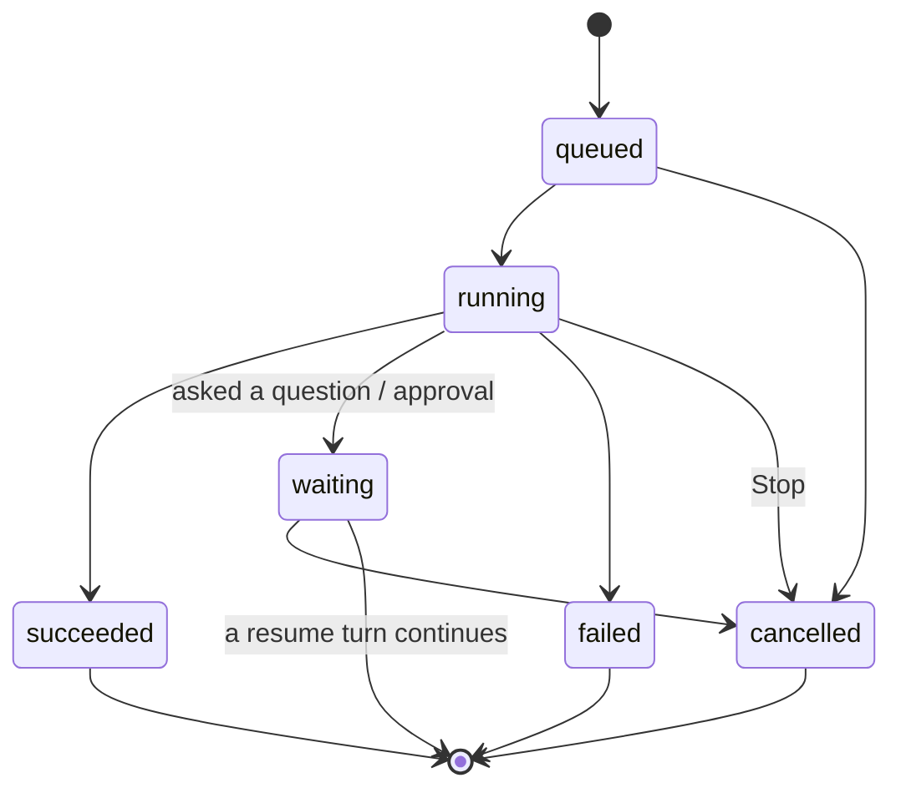

# F04 — Agent runtime: threads, sessions and turns

| Phase | Rank | Effort | Depends on | Needed by |
|-------|------|--------|-----------|-----------|
| 0 Foundations | 5 | L | F01, F02, F03, F05 | F06, F13, F15, F22, F24 |

## What it is

The heart of Shitsuji rebuilt around three concepts, plus the loop that runs a turn:

| Concept | Meaning | Lifetime |
|---------|---------|----------|
| **Thread** | Your one conversation with Shitsuji, shared by every channel | Until you reset it |
| **Session** | One line of work with its own transcript: the main chat, a task, a schedule run, the observer, a helper | Across many turns |
| **Turn** | One run of the agent, started by a message, a task dispatch, a schedule fire, an event or a resume | Until it succeeds, waits, fails or is cancelled |

## Where Shitsuji is today

`Agent.send()` adds a message to a `Session` and runs `runLoop()`: call the model, run tool calls, repeat. The
loop has no step limit, no cancellation, no streaming, and a new session is created for every message
([bugs 1, 4, 8](../00-current-state.md#bugs-and-gaps-found)). `ContextInjectable`s build the system prompt.

## Inspiration

- **nod:** one thread per owner across web, Telegram and WhatsApp; turns as rows with a source and a session;
  a session runs one turn at a time while sessions run in parallel; turns are never retried; Stop ends a turn
  at once and withdraws it; messages that arrive while a turn runs are **steered** into it at the next model
  boundary; compaction with a summary at the lightest reasoning effort; screenshot pruning.
- **OpenMausBot:** `SOUL.md` standing instructions; stall detection (two continuations with no successful tool
  call, or the same error three times).
- **Shitsuji today:** `ContextInjectable` with conditions and priorities. **Kept.**

## Design

### Turn state machine



`Turn` is a domain class that owns its transitions (`turn.start()`, `turn.waitFor(question)`, …) and throws on
an illegal one. The repository persists them with compare-and-set ([F02](F02-persistence.md)).

### Classes

| Class | Responsibility |
|-------|---------------|
| `ThreadService` | Finds or creates the owner's thread; reset archives it and starts a new one |
| `TurnScheduler` | Job handler for `session.drain`: for each session with no running turn, start its oldest queued turn |
| `TurnRunner` | Runs one turn: builds context, streams the model, executes tools, handles steering, writes the result |
| `ContextBuilder` | Composite of `ContextInjectable`s plus transcript selection and compaction |
| `Compactor` | Summarises older transcript when it nears the model's window; keeps the full transcript stored |
| `SteeringInbox` | Collects owner messages for a running session; `TurnRunner` drains it before each model call |
| `StopController` | Holds the `AbortController` per running turn; Stop aborts, then marks the turn cancelled |
| `ReplyComposer` | Sends interim updates and the final reply through the gateway ([F06](F06-channel-gateway.md)) |

### The loop

```ts
class TurnRunner {
  async run(turn: Turn): Promise<void> {
    const ctx = await this.contextBuilder.build(turn);
    for (let step = 0; step < this.limits.maxSteps; step++) {
      ctx.absorb(this.steering.drain(turn.sessionId));            // new owner messages
      const stream = this.models.select(ctx.purpose).stream(ctx.toRequest(), turn.signal);
      const { text, toolCalls } = await this.consume(stream, turn); // streams deltas to the UI
      if (toolCalls.length === 0) return this.finish(turn, text);
      for (const call of toolCalls) {
        const outcome = await this.tools.execute(call, ctx.toolContext());
        if (outcome.kind === 'needs_approval' || outcome.kind === 'question') return this.wait(turn, outcome);
        ctx.addToolResult(call, outcome);
      }
      if (this.stall.detect(ctx)) return this.fail(turn, 'stalled', this.stall.reason());
      if (this.compactor.shouldCompact(ctx)) await this.compactor.compact(ctx);
    }
    return this.fail(turn, 'step_limit');
  }
}
```

Limits are configurable per session kind (`chat: 40 steps`, `task: 200`, `helper: 30`). Spending check-ins
come from [F22](F22-observability-and-cost.md).

### Context building

The system prompt is assembled from `ContextInjectable`s, ordered by priority, as today. The set grows:

| Injectable | Condition | Content |
|------------|-----------|---------|
| `IdentityInjectable` (kept) | always | Name, persona, writing rules |
| `SoulInjectable` | always | The owner-editable `SOUL.md` standing instructions |
| `OwnerContextInjectable` | always | Name, time zone, local time, locale |
| `RulesInjectable` (kept) | always | Safety and behaviour rules; untrusted-content rule |
| `ToolIndexInjectable` (was `ToolListInjectable`) | always | Core tools are sent as schemas; this lists deferred tool names only |
| `SkillIndexInjectable` | always | Skill names and descriptions ([F14](F14-skills.md)) |
| `MemoryIndexInjectable` | when memory is on | Confirmed notes first ([F13](F13-long-term-memory.md)) |
| `TaskLedgerInjectable` | chat sessions | Open tasks and recent results ([F15](F15-tasks-and-subagents.md)) |
| `ChannelStyleInjectable` | per reply channel | "Telegram: no tables or headings" |

Conditions are fixed and extended: `tool_used` reads the turn's tool calls (today it reads a field nobody
sets); `once` is tracked per session; a new `session_kind` condition selects by session type.

**Prompt-cache friendly ordering:** stable parts first (identity, rules, tool schemas), changing parts last
(memory, time, task ledger), so providers that cache prefixes (DeepSeek, Anthropic) reuse them.

### Interruptions and failures

- **Stop** aborts the model stream and every pending tool, marks the turn `cancelled` and its request
  **withdrawn**: the owner's words of that request no longer feed memory or the trust check, so the agent
  continues only if asked again.
- **A failed model request** removes what it added since the last answered request from the context, keeps
  the owner's message, and records the cause.
- **Restart** fails running turns as `interrupted` ([F02](F02-persistence.md)); the next turn is told.

## Changes to existing code

| File | Change |
|------|--------|
| `core/Agent.ts` | Split into `TurnRunner`, `ContextBuilder`, `ThreadService`; `send()` becomes "store message + enqueue turn" |
| `core/Session.ts` | Domain `Session` with kind and transcript; `remember()` / `memory` move to [F13](F13-long-term-memory.md) |
| `prompts/context/*` | Kept; condition evaluation moves into `ContextBuilder` and is fixed |

## Acceptance criteria

- Two messages from Telegram and the CLI land in the same thread and the agent sees both.
- A message sent while the agent works is answered in the same turn.
- Stop during a long tool call returns control within one second.
- A runaway loop stops at the step limit with a clear reason.
- A long conversation compacts without losing the open request.

## Risks and open questions

- Steering requires a stream boundary after each tool step. With providers that do not stream tool calls,
  steering waits for the step to finish. Acceptable.
- One thread per owner: is a single owner enough for now? We assume **yes** (one person, one Shitsuji); all
  tables carry `owner_id` so more owners can come later.
