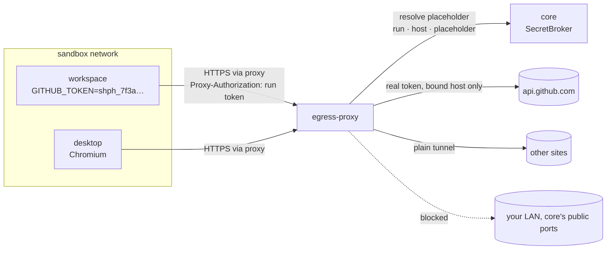

# F12 — Secrets vault

| Phase | Rank | Effort | Depends on | Needed by |
|-------|------|--------|-----------|-----------|
| 2 Own computer | 13 | M–L | F11, F09, F08 | F18, F20 |

## What it is

An encrypted store for everything secret: model API keys, the Telegram token, app OAuth tokens, website logins,
TOTP seeds, and API keys for tools the agent writes. **The model never sees a secret value, and neither does
any process the agent can change or inspect.** When a secret is needed, code the agent cannot modify puts it
where it goes: into a request header in `core`, into a request leaving the sandbox through the egress proxy,
into a sealed process, or into a field on a web page.

### The rule

> A credential is only ever held by a process the agent cannot change or inspect, and is only ever sent to the
> hosts it belongs to.

Hiding the value from the prompt is not enough. If a process the agent controls holds `GITHUB_TOKEN`, the agent
can `echo` it, write a script that posts it somewhere, or base64-encode it past the redactor, and a web page
with hidden instructions can ask for exactly that. Since Shitsuji writes its own tools ([F20](F20-tool-forge.md)),
the design assumes agent-written code is hostile.

## Inspiration

| Project | What it does |
|---------|--------------|
| **nod** | The most complete. Logins, codes and cards are entered privately on the website after a frame-origin check; `sign_in` never returns a value; TOTP codes are generated server-side, only for the login that task signed in with; known values are removed from output and masked in screenshots; a chat message that looks like a pending code never reaches the model. **Connected CLIs run sealed:** each installed as its own Linux user in a folder only it can open, each run with an environment built from scratch holding only its credential variables; code the model writes never receives the token. Credential variable names must end in `TOKEN`, `KEY`, `SECRET`, `PASSWORD`, `_ID` or `_SID`, so none can be a code-loading variable such as `LD_PRELOAD`. Its docs admit redaction cannot catch every transformation a website makes. |
| **OpenMausBot** | Secrets are **write-only**: the API only reports "configured". Saved logins and the password manager token live in a separately sealed store and are never given to the bot or page scripts. On its cloud homes, launch secrets arrive **over a pipe, not the environment**. A broker service keeps the shared Composio project key off every install, handing each one only its own session. Its threat model lists a known gap: on a shared workspace, a bot's shell can read the server's `config.json` and environment. |
| **openbot** | Keys are typed by you in settings, never by the agent; redaction on every log, export and send path; an MCP edit that would send stored headers to another origin is refused. |
| **openfuse** | OAuth tokens encrypted at rest. Its security notes say the agent's cloud desktop has open internet access, so a prompt-injected agent could send data out from it. |

**What none of them does:** let agent-written code call an authenticated API without holding the key. That is
the gap the egress proxy below fills.

## Design

### Storage

- Table `secrets(id, kind, label, ciphertext, nonce, created_at, last_used_at, rotated_at)`.
- Table `secret_bindings(secret_id, consumer, hosts, placement, approved_at, approved_by_turn)`: **where** a secret
  may go and **who** may use it (see below). A secret with no binding cannot be used.
- AES-256-GCM with a master key from a Docker secret file (preferred) or the `SHITSUJI_MASTER_KEY` variable.
  Rotation re-encrypts all rows.
- `kind`: `api_key`, `oauth_token`, `login` (username + password), `totp_seed`, `ssh_key`, `card` (later),
  `generic`.

### Bindings: who and where

Each use of a secret is described by a binding, approved by you once:

| Field | Example | Meaning |
|-------|---------|---------|
| `consumer` | `provider:deepseek`, `connector:mail/personal`, `mcp:github`, `tool:forge/gh-issues`, `browser:login` | The only component allowed to ask for it |
| `hosts` | `["api.github.com"]`, `["imap.fastmail.com:993", "smtp.fastmail.com:465"]` | The only destinations it may be sent to. Exact hosts, no wildcards beyond one subdomain level |
| `placement` | `header:Authorization=Bearer {}`, `query:api_key`, `basic`, `env:GH_TOKEN`, `form-fill` | How it is attached |

Every component that attaches a secret, in `core` or in the proxy, checks the destination against `hosts`
before sending. This also covers openbot's case: an edit that points a server at a new URL does not carry its
credentials along.

### Classes

| Class | Responsibility |
|-------|---------------|
| `SecretStore` (port) | Encrypted CRUD; returns plaintext only to `SecretBroker` |
| `SecretBroker` | Checks a request against the bindings (consumer, host, placement), hands the value over for one use, records the use |
| `PlaceholderIssuer` | Mints short-lived placeholders for a sandbox run and resolves them for the egress proxy |
| `Redactor` | Knows every active secret value and derived forms (base64, URL-encoded, hex) and replaces them in text and images. **A safety net, not the main defence** |
| `CodeGuard` | Intercepts one-time codes in chat while a code request is pending ([F06](F06-channel-gateway.md)) |
| `SecureFormService` | A private entry form (web UI only) for a value you have not saved yet |
| `SecretUseLog` | One row per use: secret, consumer, host, turn, and the owner words that allowed it ([F11](F11-trust-and-approvals.md)) |

### Ways a secret is used, safest first

| # | Route | Who uses it | How |
|---|-------|-------------|-----|
| 1 | **Attached in `core`** | Model providers, mail and calendar connectors ([F18](F18-integrations-mcp.md)), remote MCP servers | The adapter asks `SecretBroker` and adds the header or login itself. The value never leaves `core` except to its bound host |
| 2 | **Filled into a page** | Website logins ([F09](F09-browser.md)) | `browser.sign_in({ login: 'bank-main' })`: the trust service checks your words and the origin; `core` fills the fields over CDP after checking the frame's real origin; the model then sees the page with values masked. TOTP codes are computed by the server and typed the same way |
| 3 | **Swapped in by the egress proxy** | Agent-written code and forged tools ([F20](F20-tool-forge.md)) in the workspace or desktop | The sandbox only ever holds a **placeholder**; the proxy swaps it for the real value on the way out, only for the bound hosts. See below |
| 4 | **Sealed process** | Approved third-party CLIs, stdio MCP servers, non-HTTP protocols (SSH, databases), signed requests (AWS SigV4) | nod's model, see below |
| 5 | **Never** | — | A real value in the agent's shell environment, a workspace file, a prompt, a chat message or a log |

### The credential-injecting egress proxy

#### Network layout

The workspace and desktop **lose direct internet access**: they sit only on the `sandbox` network, and a new
`egress-proxy` service is the only way out. That also answers open question D3 (block your LAN and `core`).



```yaml
egress-proxy:
  build: ./containers/egress
  networks: [sandbox, internal, egress]     # the only sandbox-side service with internet
  read_only: true
  cap_drop: [ALL]
  environment:
    EGRESS_TOKEN_FILE: /run/secrets/egress_token   # authenticates the proxy to core
  secrets: [egress_token, egress_ca_key]
```

The proxy **stores no secrets**. It asks `core` for each swap and keeps the answer only for the rest of that run.

#### How a run gets placeholders

1. A forged tool's manifest declares `secrets: [{ ref: github, env: GH_TOKEN }]`, and you approved the binding
   `tool:forge/gh-issues → api.github.com, header:Authorization=Bearer {}`.
2. When the run starts, `PlaceholderIssuer` mints a random placeholder (`shph_` + 32 random characters) bound to
   **this run, this secret and these hosts**, plus a per-run proxy credential.
3. The sandbox runner starts the process with `GH_TOKEN=shph_…`, `HTTPS_PROXY` pointing at `egress-proxy` with the run
   credential, and the proxy's CA certificate in the trust store.
4. The tool's code sends `Authorization: Bearer shph_…` to `api.github.com` as if it were the real token.
5. The proxy sees the placeholder in a header, asks `core`: "run R, host `api.github.com`, placeholder P". `core`
   checks run, binding, host and placement, logs the use, and returns the value. The proxy swaps it in and
   forwards the request.
6. When the run ends, its placeholders are revoked. A leaked placeholder is useless afterwards, and useless
   during the run anywhere but the bound host.

Printing the environment shows only `shph_…`. Posting it to an attacker's server sends only `shph_…`.

#### What the proxy does

- **Intercepts TLS only for hosts that have a binding** for the current run; every other HTTPS connection is a
  plain `CONNECT` tunnel it never opens. Browsing and package installs are untouched, and certificate-pinning
  clients only break on bound hosts.
- Looks for placeholders **only where the binding's placement says** (a header, a query parameter, basic auth).
  A placeholder found anywhere else, or bound for another host, is **not swapped**, the request is refused, and
  the attempt is logged and shown in the run's receipt.
- **Strips the real value from responses** for bound hosts (some APIs echo keys back), before the tool sees it.
- **Blocks** private address ranges, link-local and metadata addresses, and `core`'s ports, by IP after DNS
  resolution so a hostname pointing at your LAN cannot slip through.
- Applies the run's network allowlist from the tool manifest ([F20](F20-tool-forge.md)) and per-run byte limits.
- Desktop Chromium uses the proxy in **tunnel-only mode**: no swaps (logins use route 2), but the same LAN
  blocking.

#### Building it

Ideas only, no code taken from anywhere. Two reasonable options:

- **A small Node service** in the monorepo: an HTTP `CONNECT` proxy that terminates TLS for bound hosts with
  leaf certificates signed by its own CA, then forwards with Node's `https` client. Same language and test
  setup as everything else.
- **mitmproxy with a short addon** that calls `core` for swaps. Mature TLS handling, but a Python service to
  maintain beside the TypeScript ones.

Proposal: the Node service, because the logic is small and it must share types with `core`'s broker API.
The CA key lives only in the `egress-proxy` container (Docker secret); its certificate is baked into the workspace
and desktop images.

### Sealed processes (route 4)

For tools that cannot work through placeholders: CLIs with their own protocols, SSH and database clients,
requests that must be signed with the secret itself (AWS SigV4), and stdio MCP servers.

- Installed from a **declared, pinned source** (npm, PyPI via `pipx`, an HTTPS release with a checksum) into a
  folder owned by **its own Linux user** in the workspace. Neither the agent's user nor another tool can change
  it or read its files.
- Each run gets an **environment built from scratch**: a fixed `PATH`, a private temporary home, and its
  credential variables only.
- Credential variable names must match nod's rule (`*TOKEN`, `*KEY`, `*SECRET`, `*PASSWORD`, `*_ID`, `*_SID`);
  `LD_*`, `NODE_OPTIONS`, `PYTHON*` and similar are refused.
- The value is handed over through a **pipe or a one-time file descriptor**, which the launcher turns into
  the variable inside the sealed user, so it never appears in the workspace daemon's own environment or
  command line (OpenMausBot does this for its cloud homes).
- The agent can pass files and arguments; output comes back redacted and marked untrusted.
- **Never for code the agent can still edit.** A forged tool becomes eligible only as an approved, immutable
  version ([F20](F20-tool-forge.md)), and even then route 3 is preferred when the tool speaks HTTP.

### Rules

- The agent never asks for a password or key in chat; it calls `secrets.request({ kind, label, reason, hosts })`,
  which sends you a link to the private form in the web UI. Telegram never carries secret values.
- A new binding, or a change to a binding's hosts, is `write_self` and **always** asks, with the hosts shown
  plainly on the card.
- Background, observer and helper turns can use existing bindings within their work, but cannot create or widen
  one.
- Settings APIs return `configured: true`, never the value. There is no "reveal" button in the web UI.
- Redaction runs on every tool result, log line, receipt and trace ([F05](F05-tool-system.md),
  [F22](F22-observability-and-cost.md)).
- The web UI's **Secrets** page shows each secret's bindings and its recent uses from `SecretUseLog`.

## Acceptance criteria

- A saved login signs in to a test site; no plaintext appears in the transcript, logs or screenshots.
- A forged tool that prints its whole environment shows only placeholders.
- The same tool calls a mock API on its bound host and succeeds; the mock server receives the real value.
- Sending the placeholder to an unbound host is refused, logged and shown in the run's receipt; the unbound
  host receives nothing.
- A placeholder copied out of a finished run is rejected by the proxy.
- The real value is never present in the workspace's files, process environments or command lines, checked by
  scanning `/proc` and the filesystem during and after a run.
- From the workspace, a request to a LAN address or to `core` fails at the proxy, including through a hostname
  that resolves to a private IP.
- A sealed CLI receives its token; the agent's user cannot read the tool's folder or `/proc/<pid>/environ`.
- Typing a 6-digit code in Telegram while a code is pending fills the site and never reaches the model.

## Risks and open questions

- **The master key** is only as safe as the host. Prefer a Docker secret file; document the backup.
- **TLS interception is real code to get right** (certificate generation, HTTP/2, streaming bodies). Keep the
  interception limited to bound hosts and test it with recorded API sessions.
- **Clients that ignore `HTTPS_PROXY`** simply have no internet, because the sandbox network has no other way
  out. That is the point, but some tools will need a nudge (`git` and `pip` respect the variables; some Go and
  Rust binaries need flags).
- **APIs that want the key inside a JSON body** need a body placement with a declared field path; add it only
  when a real tool needs it.
- **Password manager integration** (Bitwarden / Vaultwarden, 1Password as nod does) could replace storing logins
  in Shitsuji. Later.
- **Desktop apps that need credentials** (a mail client in the desktop, say) are out of scope at first; the
  agent uses the connectors in `core` instead.
