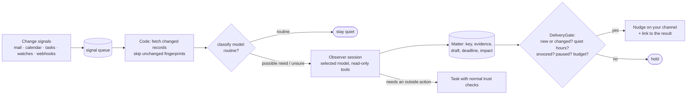

# F17 — Proactivity engine

| Phase | Rank | Effort | Depends on | Needed by |
|-------|------|--------|-----------|-----------|
| 4 Autonomy | 19 | L | F11, F13, F16, F18 | — |

## What it is

The part that makes Shitsuji a **proactive** assistant rather than a responsive one. An observer watches change
signals from your connected apps, tasks and watches; decides cheaply whether anything needs you; prepares the
work (a draft reply, a plan, a comparison); and sends a **nudge** only when there is a concrete reason to
interrupt you, respecting quiet hours, snoozes and a budget.

## Inspiration

- **nod** (the reference design):
  - work starts only for a **concrete unhandled need**: a request to you, a commitment, a problem, a financial
    risk, a recoverable cost, or what your notification rule asks for; ideas and routine updates start nothing;
  - change signals are read **in code first** (Gmail history, calendar change tokens, task changes); unchanged
    sources cost no model call;
  - a **small classification model** can skip a whole batch of clearly routine changes; uncertain cases reach
    the main model;
  - saved **matters** with a stable key, so the same issue never opens twice; one nudge per matter, again only
    on a material evidence change;
  - **quiet hours**, snooze, pause; a high-impact matter with a deadline before quiet hours end can still go out;
  - the observer has read-only tools; outside actions start a separate task with normal trust checks;
  - a separate monthly **preparation allowance** with cost reservations;
  - every nudge links to the full prepared result.
- **OpenMausBot:** "Keep an eye on my day" as one ordinary routine; one daily brief card edited in place,
  posted only when it has something.
- **openfuse:** Ideas with source evidence that you can accept, edit or dismiss.

## Design

### Pipeline



### Classes

| Class | Responsibility |
|-------|---------------|
| `SignalCollector` | Polls or receives change signals from connectors ([F18](F18-integrations-mcp.md)), tasks ([F15](F15-tasks-and-subagents.md)) and watches ([F16](F16-scheduler-and-routines.md)); stores them |
| `SourceDiffer` | Reads changed records within a page and size budget; compares versions with the last assessment |
| `BatchClassifier` | One cheap `classify` model call per batch: "only routine?" — can only skip, never act |
| `Observer` | A dedicated session with read-only tools (`read_source`, `memory.find`, `history.search`) plus `matter.save` and `task.start` |
| `MatterRepository` | Matters keyed by source record and condition; status `open / resolved / dismissed / snoozed` |
| `DeliveryGate` | Server rules: once per matter, quiet hours, snooze, pause, budget; the model cannot override them |
| `DailyBrief` | Optional morning card built from open matters and today's calendar, without a model call, posted only when non-empty |

### Settings

- **Notification rule** (your words): what is worth interrupting you for. It is the observer's only authority
  for starting outside work ([F11](F11-trust-and-approvals.md)).
- Quiet hours and time zone; pause switch; preparation allowance ([F22](F22-observability-and-cost.md)).
- Feedback: "fewer of these" / "not useful" is stored and given to the observer next time.

### Matter format

```ts
interface Matter {
  key: string;                 // hash of primary record + condition
  title: string;
  kind: 'request' | 'commitment' | 'problem' | 'financial_risk' | 'deadline' | 'rule';
  evidence: Array<{ recordRef: string; excerpt: string; readAt: Date }>;
  draft?: { kind: 'reply' | 'plan' | 'comparison'; content: string; files: FileRef[] };
  deadline?: Date;
  impact: 'low' | 'medium' | 'high';
  status: 'open' | 'resolved' | 'dismissed' | 'snoozed';
  lastNudgedAt?: Date;
}
```

Before saving, the server re-reads the cited records (or requires a read in the last two minutes), so a nudge
never rests on stale facts.

## Acceptance criteria

- An email asking you for a document by Friday becomes one matter with a draft reply and one nudge; a later
  "thanks" in the same thread resolves it without a nudge.
- During quiet hours, a routine matter waits; a high-impact one with a deadline before morning goes out.
- Newsletters cost at most one classification call per batch and produce nothing.
- The observer never sends an email itself.

## Risks and open questions

- Getting "worth an interrupt" right is the hardest part. Start with **opt-in**, a strict notification rule, and
  the daily brief; tune with your feedback and eval scenarios.
- Cost: keep classification on the cheapest model (a local one when hardware allows).
