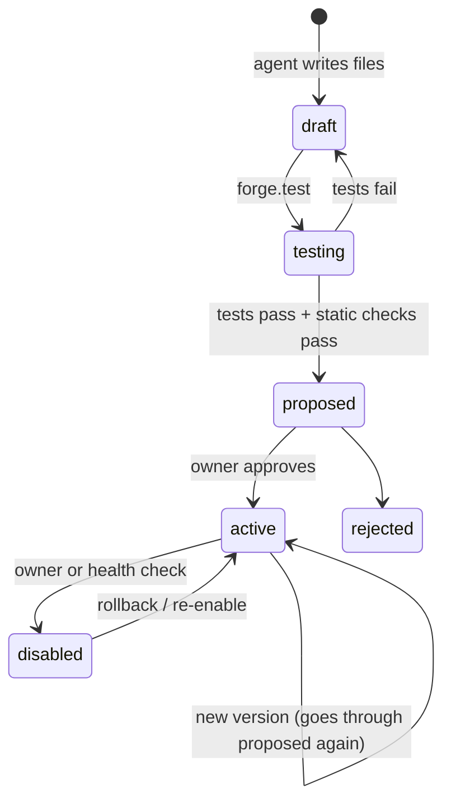

# F20 — Tool forge: self-authored tools

| Phase | Rank | Effort | Depends on | Needed by |
|-------|------|--------|-----------|-----------|
| 5 Self-evolution | 21 | L | F05, F08, F10, F11, F12 | F21 (shares the review and rollback flow) |

## What it is

Shitsuji writes **new tools for itself**. When it keeps doing the same multi-step job, or needs a capability
it lacks (parse a bank's statement format, call a public API, automate a desktop app), it writes a small
program in its workspace or desktop, tests it there, and **proposes** it as a tool. After your approval, the
tool is registered and appears in `tool_search` like any other, but it still **runs only inside the sandbox**,
with declared permissions, a version history and one-click rollback.

You asked for this in both environments: tools for the workspace and tools for the desktop.

## Inspiration

- **openfuse:** "a managed registry for generated tools" and "managed tool installation/versioning" are on the
  roadmap; generated scripts already run in the private Linux workspace.
- **openbot:** agents add MCP servers themselves, but only after an approval that says every agent will get
  the tools; a server that fails its test is not saved.
- **nod:** connected CLIs run sealed: their own Linux user, an environment built from scratch, credentials only
  for that process.
- None of the four projects ships this today. This design is ours.

## Design

### Tool package

A forged tool is a folder in the workspace's `tools/` area:

```
/workspace/tools/<name>/
├── tool.yaml          manifest
├── main.py | main.ts  entry point: reads JSON args on stdin, writes JSON result on stdout
├── test/              cases: input → expected output (or a check script)
└── README.md          what it does, written by the agent
```

```yaml
name: bank-statement-parser
version: 3
description: Parse a CSV statement from <bank> into normalised transactions.
runtime: python3.12          # or node22, bash; desktop tools: "desktop-python" (has DISPLAY and xdotool)
target: workspace            # or desktop
input_schema: { … JSON Schema … }
output_schema: { … }
effect: read                 # declared; the forge checks it against the permissions below
permissions:
  network: none              # none | public | allowlist: [api.example.com]
  secrets: []                # e.g. [{ ref: github, env: GH_TOKEN }]: the run gets a placeholder; the
                             # egress proxy swaps in the real value for the bound hosts only (F12)
  files: [handoff]           # extra mounts the run may read/write
limits: { timeout_s: 60, memory_mb: 512 }
```

### Lifecycle



### Classes

| Class | Responsibility |
|-------|---------------|
| `ToolForge` | Facade for the agent's forge tools |
| `ToolManifestValidator` | Schema-validates `tool.yaml`; refuses unknown runtimes, wide permissions without reason, `effect` lower than the permissions imply (network access ⇒ at least `external` unless allowlisted read-only) |
| `ForgeTestRunner` | Runs the tests in a **fresh, network-less** run in the workspace (or desktop) and records results |
| `StaticChecks` | Cheap safety checks: no reading of `/proc/*/environ`, no writes outside allowed folders, dependency list pinned |
| `ToolProposal` | Bundles manifest, code diff since the last version, test results and the agent's reason for your review |
| `ForgedToolRegistry` | Stores approved versions (content-hashed copies outside the agent's writable folder) and registers them as `ForgedTool`s |
| `ForgedTool extends BaseTool` | Runs the approved copy through the sandbox runner with the declared limits, network and secrets; output is untrusted data |
| `ToolHealthMonitor` | Counts failures per version; disables a tool that keeps failing and notifies you |

**Approved copies are immutable.** The registered tool runs from a content-hashed copy that the agent cannot
edit. A change to the working folder has no effect until it is proposed and approved again.

### Agent-facing tools

| Tool | Effect |
|------|--------|
| `forge.scaffold({ name, runtime, target })` | `write_local` |
| `forge.test({ name })` | `write_local` |
| `forge.propose({ name, reason })` | `write_self`, always asks |
| `forge.list`, `forge.status` | `read` |

### Approval card

Shows: name and description, target and runtime, **permissions** (network, secrets, files), effect, test
results, a diff against the active version, and the agent's reason. Buttons: Approve, Reject, Approve without
network.

### Desktop tools

Same flow with `target: desktop`: the run gets `DISPLAY=:0` and `xdotool`, so a tool can automate a GUI app
(for example, export a report from LibreOffice). Desktop tools take the desktop lock while running
([F15](F15-tasks-and-subagents.md)).

### Relation to MCP

A forged tool could also be packaged as a small MCP server. We keep the stdin/stdout contract for the first
version (simpler to test and sandbox) and can add an "export as MCP server" option later.

## Acceptance criteria

- The agent writes, tests and proposes a parser; after approval it appears in `tool_search` and runs in the
  workspace with no network.
- Editing the working copy does not change the active tool until a new version is approved.
- A tool that requests network access shows it clearly on the card; rejecting network keeps the tool offline.
- Rollback to the previous version is one click and takes effect on the next call.

## Risks and open questions

- The agent could write a tool that is technically within its permissions but misleading. Mitigation: the
  output is untrusted data, effects are re-checked per call by the trust service, and tools never gain more
  than the workspace already had.
- Dependency installation (pip/npm) inside tools: allow only pinned versions, installed during `forge.test`
  into the tool's own folder, and copied with the approved version.
