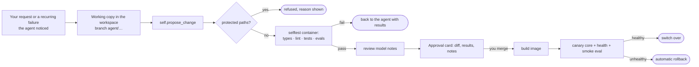

# F21 — Self-modification pipeline

| Phase | Rank | Effort | Depends on | Needed by |
|-------|------|--------|-----------|-----------|
| 5 Self-evolution | 23 (design now, build last) | L | F08, F20, F22 | — |

## What it is

Shitsuji proposing changes to **its own source code**: fixing a bug it hit, adding a channel, improving a
prompt piece, writing a new built-in tool. You said this sounds great but needs proper safeguards. None of the
four reference projects does it (see [01-inspiration-survey.md](../01-inspiration-survey.md#does-anyone-let-the-agent-change-its-own-code)).
This file is a design to discuss, not a commitment to build soon.

The core idea: **the running Shitsuji never edits itself.** It works on a copy of its code in the workspace,
like a contributor working on a fork. Changes reach production only through the same path a human change
would: a branch, tests, review by you, a controlled rollout with automatic rollback.

## Threat model

What can go wrong when an agent edits its own code:

| Risk | Example |
|------|---------|
| Weakened safety | It "fixes" an annoying approval by loosening `TrustService` |
| Escalated access | It mounts the Docker socket or adds a secret to the workspace |
| Hidden behaviour | A change that does what it says plus something else |
| Broken system | A bug that stops Shitsuji from starting, so it cannot fix itself |
| Prompt injection | A web page convinces it to "improve" itself in a harmful way |
| Drift | Many small changes nobody reviewed end up changing its character |

## Safeguards

1. **Separation of the running system and the working copy.**
   - The workspace holds a git clone of the Shitsuji repository (read access to the remote, push only to
     `agent/*` branches, or no push: patches exported as files).
   - The `core` container runs from an image built by CI or by you. It has no write access to its own code.
2. **Protected paths.** Changes that touch these are refused by the pipeline, whatever the review says, unless
   you edit a separate allowlist yourself:
   `src/application/trust/**`, `src/adapters/secrets/**`, `composition/**` security wiring,
   `containers/**` hardening, `docker-compose*.yml`, `.github/**`, the protected-paths list itself.
3. **Proposals, not deploys.** The agent's only tool is `self.propose_change({ branch, summary, reason })`
   (`write_self`, always asks). It cannot merge, build images or restart services.
4. **Automatic checks in a separate container.** A `selftest` container (no secrets, no network except the
   package registry) runs: type check, lint, unit tests, import-direction check ([F01](F01-core-architecture.md)),
   the context-budget check, and the **eval suite** ([F22](F22-observability-and-cost.md)), including the safety
   scenarios. Any failure blocks the proposal.
5. **A second opinion.** A separate review model call, with no access to the agent's conversation, reads the
   diff and lists risks; the summary is attached to the approval card. Advisory only.
6. **Human review.** You see the diff, the test and eval results, the reviewer's notes and the agent's reason,
   and you merge (in the web UI or on GitHub).
7. **Canary rollout.** After merge, a new `core` image starts beside the old one with the same database, runs
   health checks and a smoke eval, then takes over. If health fails within a window, the old image comes back
   automatically. Database migrations from agent changes are forbidden in the first version.
8. **Audit and rate limit.** Every proposal is logged with its trigger (which turn, which owner words). At most
   N open proposals; none from background or observer turns, only from work you started.

### Pipeline

## Staged rollout of this feature

| Stage | The agent may | Notes |
|-------|---------------|-------|
| 0 | Nothing | Today |
| 1 | Write a **bug report** with a reproduction and a suggested fix in Markdown | Cheap, useful, no risk |
| 2 | Produce a **patch file** in the workspace that you apply yourself | No CI integration needed |
| 3 | Open a **branch** that runs the selftest pipeline; you merge | Needs `selftest` container and evals |
| 4 | Canary deploy after your merge, with automatic rollback | Needs the deploy controller |

Stages 1 and 2 can arrive soon after the workspace ([F08](F08-workspace-sandbox.md)). Stages 3–4 come after the
eval harness is good enough to catch regressions.

## What is **not** self-modification

Learned skills ([F19](F19-learned-skills.md)), forged tools ([F20](F20-tool-forge.md)) and profiles
([F24](F24-agent-profiles.md)) change behaviour through data, inside the sandbox, and are easy to roll back. They
cover most "get better over time" needs without touching code. Self-modification is for the remaining cases.

## Acceptance criteria (stage 3)

- A proposal that changes `TrustService` is refused before tests run.
- A proposal with a failing safety eval cannot be approved.
- The agent has no credential that can push to `main` or build images.

## Open questions

- Where does the "real" repository live: a GitHub repo, or a local bare repo in a volume? (Local is simpler and
  keeps the agent off GitHub.)
- Who builds images: GitHub Actions, or a `builder` service in Compose that only you can trigger?
