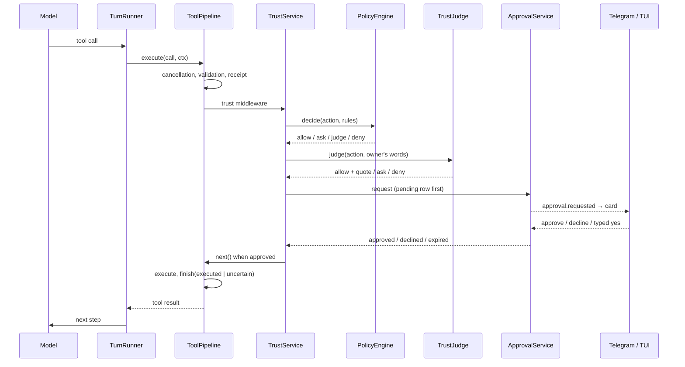

# A tool call that needs your approval

This page follows one action the policy will not run silently: from the model's tool call, through the
trust decision and the approval card, to the owner's answer and the turn carrying on. The guarantees
worth knowing are that an approval is bound to one exact action, that the card is durable before it is
shown, that an approved action runs at most once, and that an action which may have run is never
retried. It assumes the stack is running (see [Startup](./startup.md)) and picks up inside a turn (see
[A message's journey](./message-journey.md)).

## 1. The call reaches the pipeline

The model's call arrives at [TurnRunner.executeTool](../../packages/core/src/application/runtime/TurnRunner.ts),
which publishes `tool.started` and hands it to [ToolPipeline.execute](../../packages/core/src/application/tools/ToolPipeline.ts).
No tool code has run yet: the [cancellation](../../packages/core/src/application/tools/middlewares.ts) step has
noted the turn's signal, [validation](../../packages/core/src/application/tools/middlewares.ts) has parsed
the arguments with the tool's own schema, and the receipt step has written `tool_start`. A tool that
fails validation never reaches the trust decision at all.

## 2. The exact action is hashed

The trust step builds an [ActionRequest](../../packages/core/src/application/trust/ActionRequest.ts) from the
tool name, the validated arguments, the effect (which may depend on the arguments) and the target. Its
`hash` is a SHA-256 over a canonical JSON form: keys sorted, `undefined` dropped, arrays in order. **The
hash is what an approval covers** — not the tool name — so a yes for "send this email" cannot run a
different email, and the card stores a clipped preview of the arguments only.

## 3. The policy engine answers first

[PolicyEngine.decide](../../packages/core/src/application/trust/PolicyEngine.ts) is deterministic and runs
before any model or owner is involved, in the order the F11 decision diagram gives:

- a `deny` rule, then an `ask` rule, bind **every** effect, reads included; a `deny` or `ask` for a tool
  is the most natural standing rule, and it cannot be argued away;
- `read` and `compute` run without an approval;
- `write_local` follows the owner's approval level (`auto-edits` by default, P6: allowed; `ask`: a card);
- `payment` always asks, whatever the level or a rule says;
- `write_self` and `external` may be allowed by an `allow` rule (an `allow` never covers a change to
  Shitsuji itself), and otherwise go to the judge — with `quoteRequired` on for the default level, so
  the judge must quote the owner to allow an outside action.

The engine returns one of `allow`, `ask`, `judge` or `deny`; the trust service escalates only `judge`.

## 4. The judge may allow only by quoting you

[TrustJudge.judge](../../packages/core/src/application/trust/TrustJudge.ts) calls the `trust` purpose with
temperature 0 and sees two things only: the owner's words (the recent owner messages, resolved by
[AuthorityResolver](../../packages/core/src/application/trust/Authority.ts)) and the exact action. Tool
output, assistant text and page content are never authority. The call has a ten-second timeout and any
error, timeout or malformed answer becomes **ask**, so the owner is never bypassed by a failure.

An allow is accepted only with a quote, and the quote is checked on the server:
[QuoteVerifier](../../packages/core/src/application/trust/QuoteVerifier.ts) requires three characters or
more and a verbatim substring of one owner message (or the routine's instruction). A made-up or
paraphrased quote sends the call to the owner instead. An allow that came with a verified quote is
recorded with `basis: { kind: 'quote' }`; an ask with no usable quote is recorded with the reason the
owner sees on the card.

## 5. A durable card, then a wait

An `ask` verdict — from the engine, the judge, or a judge failure — goes to
[TrustService.askOwnerIfNeeded](../../packages/core/src/application/trust/TrustService.ts). Two shortcuts
apply before a new card is made: a **decline of the same action earlier in this turn** refuses it again
without asking (`declinedFor`), and a stored card is always inserted before it is published, so a
restart cannot lose a question it already asked.

[ApprovalService.request](../../packages/core/src/application/trust/ApprovalService.ts) writes the
`pending` [Approval](../../packages/core/src/domain/model/Approval.ts), publishes `approval.requested`,
and waits. **The turn does not change status for this**: the tool call is blocked inside the running
turn, and the turn stays `running`. (The `waiting` status is the other pause — the budget check-in in
[TurnRunner](../../packages/core/src/application/runtime/TurnRunner.ts) — where the question is stored as
the reply and the owner's next message starts a `resume` turn.) While the card is open, the turn holds
its row: a Stop expires the card, and background work expires it after 30 seconds
(`backgroundApprovalWaitMs`), so no task waits forever.

## 6. How the card reaches you, and how you answer

[Shitsuji.deliverApproval](../../packages/core/src/composition/Shitsuji.ts) reads the turn's `replyChannel`,
finds the adapter that actually started, and delivers a `question` intent with an `approval` part. On
Telegram that is a card with **Approve** and **Decline** buttons whose callback data is `y:<id>` or
`n:<id>`; the adapter answers the press with a toast and edits the card to say what happened. In the TUI
the same event arrives over the live WebSocket, and `/approve <id>` or `/decline <id>` answers it (the
TUI shows the first eight characters of the id). A channel without buttons degrades the card to text,
and a typed reply is read on its own by
[TypedApprovalReader](../../packages/core/src/application/trust/TypedApprovalReader.ts): only an
unconditional yes approves, so "yes, but to Bob" is unclear. An unclear reply is treated as an ordinary
owner message instead: it steers into the turn, the open card is superseded (so the blocked call wakes
expired), and the model can answer and ask again if it still needs the action. When a session has more
than one card open, the gateway refuses to guess and tells the owner to use the buttons on the card they
mean.

Every path ends in [ApprovalService.resolve](../../packages/core/src/application/trust/ApprovalService.ts),
which is a compare-and-set on `pending`: the first answer wins, a second press returns the state that
won, `approval.resolved` is published, and the waiting call wakes with the stored approval. Nothing is
delivered and retried by hand: a failed card delivery is logged, and the approval row is the truth.

## 7. An approved action runs once

On approval the trust middleware records `basis: { kind: 'owner' }` and the approval id, calls the rest
of the chain, and then reports the ending through `ApprovalService.finish`: `executed` when the tool
returned normally, `uncertain` when it threw or the turn was stopped while it ran. A decline or an
expiry becomes a `denied` tool result — the model is told the action was refused and continues with that
answer, which is a normal outcome, not a crash.

The receipt in [ReceiptMiddleware](../../packages/core/src/application/tools/middlewares.ts) keeps the
same story in `turn_events`: the effect, the target, the redacted arguments, the outcome and the
`allowedBy` basis with the action hash. The activity log therefore shows refused calls too.

## 8. Expiry, superseding and restart

A card can end without an answer, and each way is deliberate:

- **Stop** expires the card ("the turn stopped"), the call wakes denied, and the runner cancels the turn
  and withdraws its messages.
- **A new owner message** supersedes the session's open cards after the message is stored, with the
  reason "the owner sent a new message". The blocked call wakes expired, and the new message is steered
  into the running turn or queued behind it.
- **Background work** expires after the configured wait, because a schedule or a task cannot hold a turn
  open forever.
- **A restart** is [StartupRecovery.recoverApprovals](../../packages/core/src/application/StartupRecovery.ts):
  `pending` cards become `expired`, and `approved` cards — which may have run before the process died —
  become `uncertain`.

Expiry is a refusal, not a retry: the action did not run, the model sees a denied result, and the owner
can ask again later if they still want it.

## 9. `uncertain` is never retried

An approved action that failed, was stopped mid-run, or was still `approved` at the next start becomes
`uncertain` — "it may have run". The server never repeats it, because a second attempt could duplicate
an outside effect. The evidence survives: the receipt keeps the failed outcome, and an approval that was
open when the process died leaves the turn `running`, so
[StartupRecovery](../../packages/core/src/application/StartupRecovery.ts) fails it and appends the
"your previous turn was interrupted… tools it called may have partly run" note to the session, which the
next turn reads before repeating anything. The same rule appears in the domain: nothing leaves
`executed` or `uncertain` in [Approval](../../packages/core/src/domain/model/Approval.ts).

## 10. Where this lives

- The decision: [TrustService](../../packages/core/src/application/trust/TrustService.ts),
  [PolicyEngine](../../packages/core/src/application/trust/PolicyEngine.ts),
  [TrustJudge](../../packages/core/src/application/trust/TrustJudge.ts),
  [QuoteVerifier](../../packages/core/src/application/trust/QuoteVerifier.ts).
- The card and the answer: [ApprovalService](../../packages/core/src/application/trust/ApprovalService.ts),
  [Approval](../../packages/core/src/domain/model/Approval.ts), the `approval` part in
  [ChannelAdapter](../../packages/core/src/ports/ChannelAdapter.ts).
- The middleware that ties it to the tool call:
  [middlewares.ts](../../packages/core/src/application/tools/middlewares.ts), [ToolPipeline](../../packages/core/src/application/tools/ToolPipeline.ts).
- The feature spec: [F11 trust and approvals](../features/F11-trust-and-approvals.md).
