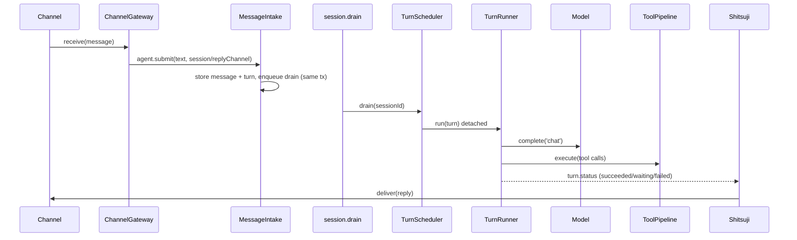

# A message's journey

This page follows one owner message from a channel to the reply. It assumes the stack is running
(see [Startup](./startup.md)); the interesting guarantees are one turn per session, steering and the
compare-and-set that makes a duplicate start harmless.

## 1. A channel receives the message

Every adapter started by `Shitsuji` gets a sink whose `receive` calls `ChannelGateway.receive`.
The gateway resolves the chat's binding and pairing first. An unpaired chat can only pair with
`/start`; commands (`/stop`, `/status`, `/new`) are answered there without a model call. A message
that is not a command is stored and queued as a turn, with the reply channel
`"<channel>:<chatId>"` so the answer goes back the way it came.

## 2. `Agent.submit` stores and queues (or steers)

`Agent.submit` delegates to `MessageIntake.submit`, which runs one transaction:

- it finds the owner's thread and the session (the existing one, or the main chat, or a new one);
- if a turn is running, the message joins it (steering) and the turn is not re-queued;
- otherwise it appends the message to the session's queued turn, or creates a `queued` turn (a
  `resume` turn when the last one is `waiting`) and enqueues `session.drain` in the same
  transaction.

After the commit it publishes `message.received` and either `turn.steered` or
`turn.status: queued`. A failure to expire pending approval cards is logged and does not lose the
message.

## 3. `session.drain` starts at most one turn

`TurnScheduler.start()` registered a keyed `session.drain` worker with the durable queue. For a
session with no running turn, the handler picks the oldest queued turn whose `startAfter` has
passed, moves it to `running` and calls `TurnRunner.run` **detached**: the job returns after the
start, so a long turn never hits the job's expiry. The start is a compare-and-set
(`update(next, 'queued')`); if another worker won, this one does nothing. When the turn ends,
`afterTurn` requeues any owner message that arrived too late to be answered and enqueues another
drain if the session still has queued turns.

## 4. `TurnRunner` runs the step loop

`TurnRunner.run` publishes `turn.status: running`, resolves the SOUL revision for the session and
loops:

1. before every model call it rebuilds the context from storage, so messages that arrived during
   the turn are included. That is what steering means;
2. it asks the budget service whether this session passed the check-in amount; if so the turn
   ends as `waiting` with a question, before spending another call;
3. it calls the model, streaming text deltas as `turn.text_delta`, stores the assistant's content
   parts and, when there are no tool calls, publishes `message.sent` and ends `succeeded`;
4. when there are tool calls it runs each through the tool pipeline (validation, trust, receipts,
   the turn write fence), stores the results, and starts the next step. A repeated failing tool or
   a stall ends the turn as failed; the step limit ends it with a clear message.

A running turn reloads its row before each step after the first, so a turn cancelled by another
process, or by recovery, stops here instead of spending more tokens. Stop aborts the model call and
withdraws the turn's messages; the runner marks it `cancelled`. Every state change is saved with
compare-and-set.

## 5. The reply goes back

`Shitsuji` subscribed to `turn.status` at start. On `running` it asks the reply channel for a typing
indicator (fire and forget). On `succeeded`, `waiting` or `failed` it builds the outbound parts and
delivers them to the channel that received the message; `cancelled` is deliberately silent because
`/stop` already replied "Stopped.". Delivery failures are logged; a turn that has already ended is
never retried automatically.
