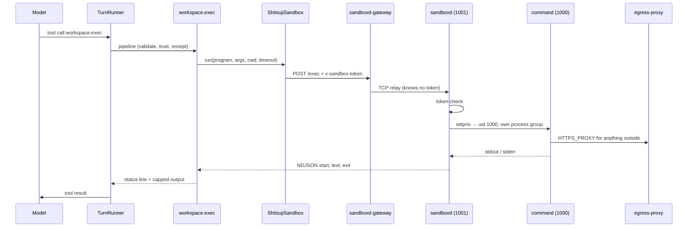

# One command in the sandbox

This page follows a `workspace.exec` call in the Compose stack, where the sandbox driver is `shitsuji`:
from core's tool to `sandboxd`, the command running as uid 1000, the deadline and the kill, the output
caps, and the one way out through egress-proxy. The guarantees worth knowing are that the command never
runs on core's host, that the sandbox has no route to core, Postgres or your LAN, that a stop or a
timeout kills the whole process group, and that neither the sandbox token nor the daemon's uid is within
a command's reach. It assumes the stack is running (see [Startup](./startup.md)).

## 1. The tool core defines

`workspace.exec` is defined in core, not in the sandbox:
[WorkspaceExecTool](../../packages/core/src/application/sandbox/tools/workspace.ts). It is registered by
[workspaceTools](../../packages/core/src/application/sandbox/tools/index.ts) only when the open sandbox
reports file and exec support, so a driver that cannot run programs never shows the model a tool that
would fail. The tool's contract is fixed whatever the driver: effect `write_local`, target `workspace`,
one program plus arguments (**no shell**, so `;`, pipes and globs are just text), a working folder inside
the workspace, and a timeout.

The limits are configuration, not the model's choice: `sandbox.tools.exec` defaults to a ten-minute
timeout, a one-hour maximum and a 1 MiB output cap
([schema.ts](../../packages/core/src/composition/config/schema.ts)). The tool caps the requested timeout
by that maximum **and** by the driver's `maxTimeoutMs`, so the two ends cannot disagree.

## 2. Core turns the call into one exec request

[WorkspaceExecTool.run](../../packages/core/src/application/sandbox/tools/workspace.ts) resolves the
folder through the file port (so `..` and links out are refused before anything starts), computes the
timeout, and consumes the driver's event stream. It keeps at most 64 MiB for the session log; when the
output is over the model's cap it writes the whole thing to
`sessions/<sessionId>/exec-<turnId>-<n>.log` and gives the model the head, the tail and the byte count
that was omitted, with the log's path. The result starts with a status line — `exit code 0`,
`timed out after Ns`, or `killed (SIGTERM)` — and a non-zero exit is an error result, not a thrown one.

## 3. The request is authenticated, then relayed

Core reaches the sandbox through [ShitsujiSandbox](../../packages/core/src/adapters/sandbox/shitsuji/ShitsujiSandbox.ts),
which sends `x-sandbox-token` on every call and parses every reply with the wire schema from
`@shitsuji/sandbox-protocol`, so a drifting daemon breaks loudly. The token is core's to make:
[SandboxTokenFile](../../packages/core/src/adapters/sandbox/shitsuji/SandboxTokenFile.ts) generates 32
random bytes on first start, in the `sandbox-secret` volume that Compose mounts read-only into the
sandbox as a seed.

In Compose, core does **not** dial the sandbox directly: it talks to `sandboxd-gateway`, a TCP relay on
the `internal` and `sandbox` networks that forwards one port and knows no token
([gateway.ts](../../packages/sandbox-daemon/src/gateway.ts)). That is what keeps the sandbox from dialing
core's API and keeps the `lanBlocked` probe honest. [sandboxd](../../packages/sandbox-daemon/src/server.ts)
compares the token in constant time and refuses everything but `/health` without it; it refuses to start
at all without one, because an unauthenticated file and exec API inside the sandbox would be usable by
anything that reaches the port.

## 4. The command drops to uid 1000

The daemon never runs a command as itself. [setprivCommand](../../packages/sandbox-daemon/src/exec.ts)
puts `setpriv` in front of every argv: `--reuid=1000 --regid=1000 --init-groups`, all inheritable and
ambient capabilities dropped, an empty bounding set, `--no-new-privs`. The daemon does that rather than
`spawn`'s `uid` option because a same-process uid change does not clear the daemon's ambient
SETUID/SETGID/KILL, and they would survive into the command.

The command starts in its own process session (`setsid`, via `detached`), with a fixed minimal
environment — `PATH`, `HOME`, `LANG`, `USER`, `SHELL`, `TMPDIR`, the proxy variables, and whatever the
request set — never the daemon's own environment.
[ExecSupervisor](../../packages/sandbox-daemon/src/exec.ts) streams stdout and stderr as separate frames
and ends with one exit frame.

## 5. The deadline, and the kill

The daemon caps the request's timeout again with its own `maxTimeoutMs` (one hour by default) and starts a
timer. On expiry it sends `SIGTERM` to the **process group** (a negative pid, so `sleep infinity &` and
other grandchildren go too), and `SIGKILL` after a two-second grace. The exit frame carries
`timedOut: true`, which is the status line the model sees.

The same path handles a Stop: the tool's signal aborts, core sends `SIGTERM` through
`/exec/:id/signal`, and the daemon kills the group. A client that simply disconnects also stops the
command, because the exec route aborts its supervisor when the response closes. The core-side reader
turns its own abort into a `Stopped` error rather than an exit code the caller ignored.

## 6. What the model gets back

The daemon caps the total output it forwards (8 MiB by default) and flags the exit `truncated`; core
keeps only the configured 1 MiB for the model, head and tail, with the omitted byte count and the log
path in the middle. Nothing is written outside the workspace and the session folder, and a Stop leaves a
partial log rather than a lost reply.

Whether the text is *marked* as untrusted is a property of the tool, not of the sandbox: the pipeline's
[untrusted-wrap step](../../packages/core/src/application/tools/middlewares.ts) wraps a successful result
only when the tool sets `untrustedOutput` (as `web.search`, `web.fetch` and the desktop computer tool do).
`workspace.exec` does not set it, so its output reaches the model as an ordinary tool result — the
receipt, not a wrapper, is what records where it came from. The receipt middleware writes `tool_start`
and `tool_end` with the effect, the target, the redacted arguments, the duration and the outcome.

## 7. The only way out: egress-proxy

The `sandbox` service joins **one** network, `sandbox`, and publishes no port; egress-proxy is the only
other member of it, and also joins `egress` to reach the internet
([compose.yaml](../../compose.yaml)). Commands inherit `HTTP_PROXY`/`HTTPS_PROXY` (and the lowercase
forms) pointing at it, and the daemon adds them to every command's environment.

The rules are core's: at startup it writes `sandbox.egress.allow/deny` to the file the proxy mounts,
with `ready: true` ([EgressRulesFile](../../packages/core/src/adapters/sandbox/EgressRulesFile.ts)). The
proxy starts **closed** on a fresh volume — Compose seeds `{"ready":false}` — and denies everything
until core has written its lists
([main.ts](../../packages/egress-proxy/src/main.ts)). Environment lists and the file are merged, so a
rule in either applies.

For each connection [createPolicy](../../packages/egress-proxy/src/rules.ts) decides from the resolved
addresses, never the name: private, loopback, link-local, CGNAT, multicast, unspecified and cloud-metadata
ranges are always refused, as is the name `core`; the deny list refuses next; a non-empty allow list then
narrows the open default to the hosts it names. The proxy resolves once, checks **every** answer and
connects to the exact address it checked, so a second DNS answer cannot swap in a private address; both
plain HTTP and `CONNECT` tunnels take the same path, and a refusal is a 403 with the reason.

## 8. Who is who, and why the split matters

| Inside the sandbox | uid | gid | Notes |
|---|---|---|---|
| Entrypoint (transient) | 0 | 0 | Copies the token, prepares `/workspace`, then drops and never runs commands |
| `sandboxd` | 1001 | 1000 | Holds the token, starts and kills commands; keeps SETUID/SETGID/SETPCAP/KILL only |
| Commands (`workspace.exec`) | 1000 | 1000 | Through `setpriv`, all capabilities dropped, own process group |
| Desktop programs | 1000 | 1000 | The XFCE session, Chromium, LibreOffice |
| VNC stream servers | 1001 | 1000 | `x11vnc`/`websockify`, so a command cannot signal them |
| Core (another container) | 1000 | 1000 + 1002 | Never on the `sandbox` network; group 1002 only lets it write the token volume |

The token is the reason for the split. It lives in `/run/sandbox/token` (mode 0400, owned by
`sandboxd`), inside a 0700 directory; the seed volume it comes from is `root:1002` mode 0770, which core
can write through group 1002 while a command (uid 1000, gid 1000) cannot even traverse it. A command with
the daemon's uid could read `/proc/<daemon>/environ` or the token file and drive the exec API itself; with
uid 1000 it can do neither, and it cannot signal the daemon or the VNC servers either.

## 9. Where this lives

- The tools and limits: [workspace.ts](../../packages/core/src/application/sandbox/tools/workspace.ts),
  [SandboxService](../../packages/core/src/application/sandbox/SandboxService.ts).
- The driver: [ShitsujiSandbox.ts](../../packages/core/src/adapters/sandbox/shitsuji/ShitsujiSandbox.ts),
  [SandboxTokenFile.ts](../../packages/core/src/adapters/sandbox/shitsuji/SandboxTokenFile.ts).
- The sandbox side: [server.ts](../../packages/sandbox-daemon/src/server.ts),
  [exec.ts](../../packages/sandbox-daemon/src/exec.ts), [auth.ts](../../packages/sandbox-daemon/src/auth.ts),
  and the entrypoint in [docker/sandbox/entrypoint.sh](../../docker/sandbox/entrypoint.sh).
- The way out: [rules.ts](../../packages/egress-proxy/src/rules.ts),
  [proxy.ts](../../packages/egress-proxy/src/proxy.ts), [address.ts](../../packages/egress-proxy/src/address.ts).
- The feature spec: [F08 workspace and sandbox](../features/F08-workspace-sandbox.md), and the egress
  rules from [F12 secrets vault](../features/F12-secrets-vault.md).
