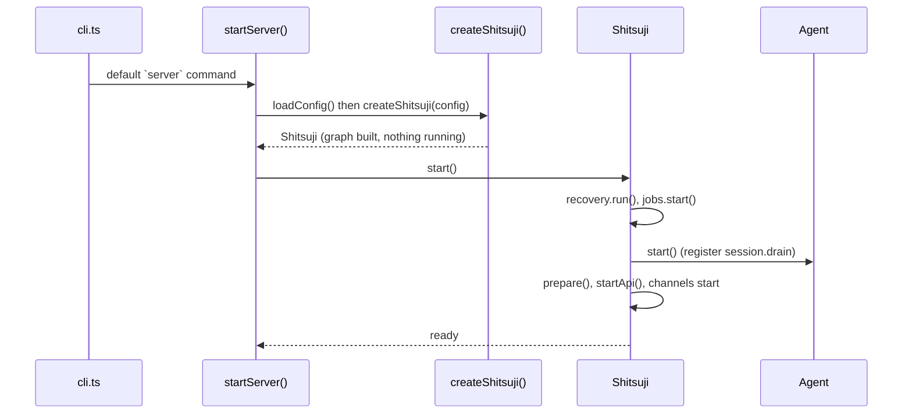

# Startup: from the CLI to the running assistant

This page follows one start of Shitsuji in order. Each step names the class or function that does
the work; open it in the API pages for the details.

## 1. `cli.ts`

The entry point reads `process.argv`. `tui` starts the terminal client instead; anything else
(default `server`) dynamically imports [startServer](../../packages/core/src/index.ts) from `index.ts`. `main()` has a single
`catch`: a `ConfigError` prints its message without a stack trace, anything else prints the error,
and the process exits 1.

## 2. [startServer](../../packages/core/src/index.ts)

[startServer](../../packages/core/src/index.ts) loads the configuration with `loadConfig()`, constructs the whole object graph
with `createShitsuji(config)`, logs where the configuration came from, and calls [Shitsuji.start](../../packages/core/src/composition/Shitsuji.ts).
It then prints the console banner and registers `SIGINT`/`SIGTERM` to call `stopServer()` and exit.
The module keeps the running [Shitsuji](../../packages/core/src/composition/Shitsuji.ts) in `running`; `stopServer()` stops it and clears it.

## 3. [createShitsuji](../../packages/core/src/composition/createShitsuji.ts)

[createShitsuji](../../packages/core/src/composition/createShitsuji.ts) is the only composition root. In order, it:

1. writes the egress rules file for the sandbox proxy and creates the services (logger, clock,
   event bus);
2. opens the database when `database.url` is set (migrations run here) or uses in-memory
   repositories;
3. builds the plugin manager, the model router and the sandbox service, and opens the sandbox;
4. builds the tool catalog and the tool pipeline, the context builder, the agent, the trust and
   budget services, the channels and the optional API, and returns a [Shitsuji](../../packages/core/src/composition/Shitsuji.ts) with all of them
   as [ShitsujiParts](../../packages/core/src/composition/Shitsuji.ts).

Nothing is listening and no turn runs yet: [createShitsuji](../../packages/core/src/composition/createShitsuji.ts) only builds and connects objects.

## 4. [Shitsuji.start](../../packages/core/src/composition/Shitsuji.ts)

`start()` is the only place that brings the graph to life, and the order matters:

1. `recovery.run()` finishes or fails turns a previous process left running;
2. `jobs.start()` starts the durable queue the scheduler registers its worker with;
3. it subscribes to `turn.status` before any turn can run, so no reply is lost;
4. `agent.start()` registers the `session.drain` worker and wakes sessions with queued turns;
5. `prepare()` runs (for example, it creates the owner key the API and channels check);
6. `startApi()` starts the HTTP API, if enabled;
7. it builds the `ChannelGateway` and starts every channel adapter, which may begin receiving
   messages immediately;
8. it subscribes to `approval.requested` (cards need the channels, so this waits for them);
9. it publishes `system.ready`.

`stop()` reverses that order: unsubscribe, close the API, stop the channels in reverse start
order, give running turns up to five seconds, stop the queue, close the sandbox, dispose plugins
and run the extra shutdown steps. Channel, queue, sandbox and shutdown-step failures are logged and
do not prevent the rest of the shutdown.

